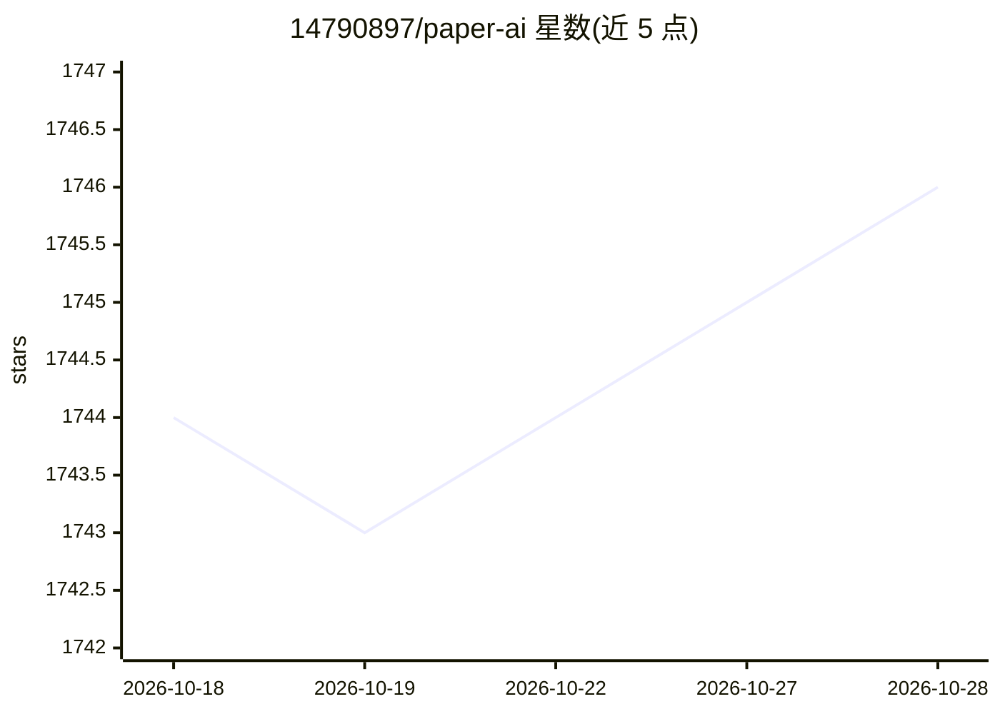

# 14790897/paper-ai

⭐ 1,746 · TypeScript · MIT · 推送 2026-05-09 · [GitHub](https://github.com/14790897/paper-ai) · [官网](https://paperai.sixiangjia.de) · 个人维护 · 中文 README

**搜索真实文献并由 AI 撰写带引用论文的 Web 应用**

基于 Next.js 的在线论文写作工具：AI 写作功能根据用户输入提供写作建议与回答；文献搜索功能按关键词在 Semantic Scholar、arXiv、PubMed 检索论文并整合进文稿，配在线编辑器直接修改生成内容。支持 GitHub/Google OAuth 登录、i18n 多语言，通过环境变量配置上游 AI 地址与 API key（兼容 OpenAI 接口形式）。提供 Vercel 一键部署、Docker 镜像与本地克隆运行三种方式，在线演示托管于 paperai.sixiangjia.de。

## 筛选速览

| 维度 | 判定 | 备注 |
|---|---|---|
| AI 角色 | `ai-native` | 本体是模型或模型工具 |
| 许可风险 | `permissive` | MIT |
| 部署形态 | `self-host` | docker 或自建部署 |
| 模型依赖 | — | README 未给出锁定关系 |
| 硬件要求 | — | 无带数字的原话,不猜 |
| 安装摩擦 | `low` | 无编译、无系统依赖或容器化 |
| 成熟度 | — | 结构信号不足 |

## 能力要点

- 按关键词在 Semantic Scholar/arXiv/PubMed 检索文献并整合进论文
- AI 写作对话互动，输出写作建议
- 在线编辑器直接编辑 AI 生成内容，调整样式与布局
- Docker/Vercel/本地克隆三种部署方式

## 适用场景

- 写论文时快速找到真实文献并引用
- 借助 AI 生成论文初稿再自行编辑修改
- 自行部署到 Vercel 或本地供团队使用

## 场景标签

`科研工具` `AI 写作` · 领域:内容生成

## 证据(README 行号)

> L26: - **人工智能书写功能**： 点击 "AI 写作 "进行正常对话互动。人工智能将根据您的输入提供写作建议或回答问题。
> L27: - **寻找文献功能**： 点击 "寻找文献"，根据输入的关键词在 Semantic Scholar 或 arxiv 或 PubMed 中搜索论文。系统将把信息整合到您的论文中。

## 星数曲线

2026-10-18 1,744 → 2026-10-28 1,746（+2）

---
*卡片 v1 · prompt 1.4 · 生成 2026-10-21 · 置信度 high · 依据 README sha `937d871d721a` · [字段定义](../../DATASET.md)*
