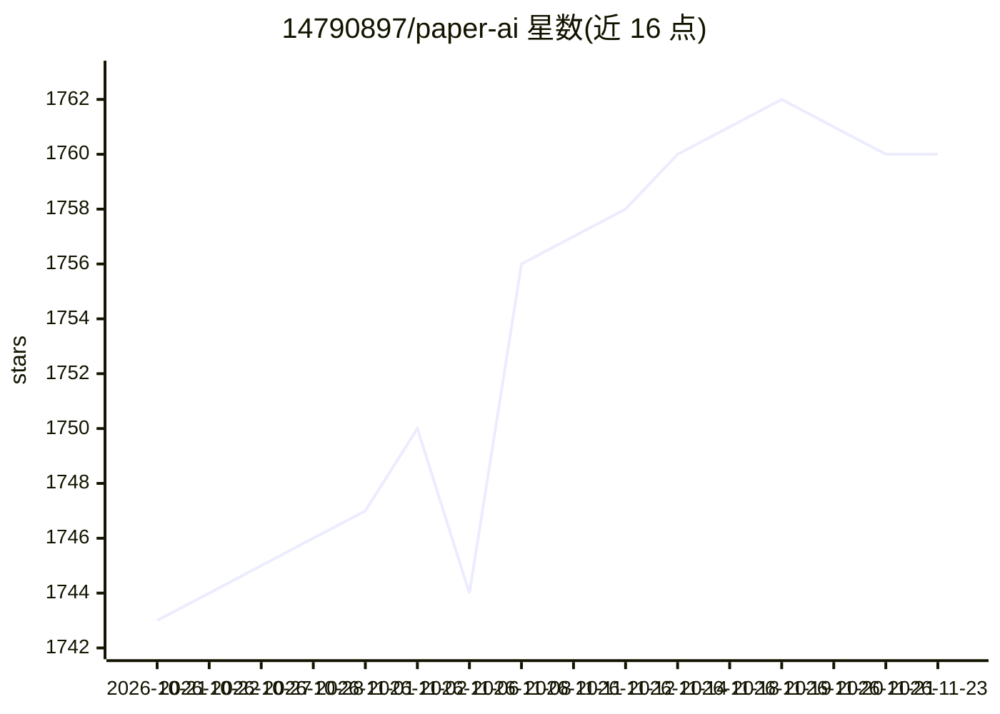

# 14790897/paper-ai

⭐ 1,760 · TypeScript · MIT · 推送 2026-11-05 · [GitHub](https://github.com/14790897/paper-ai) · [官网](https://paperai.sixiangjia.de) · 个人维护 · 中文 README

**面向写作者的检索真实文献并生成带引用论文的AI写作工具**

基于 Next.js 的网页论文写作工具：用户输入关键词后在 Semantic Scholar、arXiv、PubMed 中检索论文，将文献信息整合进 AI 生成的论文文本，编辑器基于 Quill，支持直接修改 AI 生成内容与调整样式布局。通过环境变量或设置界面配置上游 AI 模型地址与 API Key，支持 GitHub/Google OAuth 登录（Supabase）。提供 Vercel 一键部署、Docker 镜像与本地源码运行三种方式，README 另含开发踩坑记录与 API 参考文档。

## 筛选速览

| 维度 | 判定 | 备注 |
|---|---|---|
| AI 角色 | `ai-native` | 本体是模型或模型工具 |
| 许可风险 | `permissive` | MIT |
| 部署形态 | `self-host` | docker 或自建部署 |
| 模型依赖 | — | README 未给出锁定关系 |
| 硬件要求 | — | 无带数字的原话,不猜 |
| 安装摩擦 | `low` | 无编译、无系统依赖或容器化 |
| 成熟度 | — | 结构信号不足 |

## 能力要点

- 在 Semantic Scholar / arXiv / PubMed 检索真实文献并整合到论文中
- AI 写作对话交互，根据输入提供写作建议
- Quill 编辑器内直接修改 AI 生成内容
- Docker 镜像与 Vercel 部署，支持自定义上游模型地址

## 适用场景

- 根据关键词快速生成带真实文献引用的论文草稿
- 在编辑器中结合 AI 建议撰写和修改学术文本
- 自部署一个可配置上游模型的论文写作站点

## 场景标签

 · 领域:学术写作/AI 内容生成

## 证据(README 行号)

> L24: ### 利用人工智能撰写论文
> L27: - **寻找文献功能**： 点击 "寻找文献"，根据输入的关键词在 Semantic Scholar 或 arxiv 或 PubMed 中搜索论文。系统将把信息整合到您的论文中。
> L58:   -e NEXT_PUBLIC_AI_URL=自定义AI模型地址\

## 星数曲线

2026-10-21 1,743 → 2026-11-23 1,760（+17）

---
*卡片 v1 · prompt 1.4 · 生成 2026-11-23 · 置信度 high · 依据 README sha `a4ac3b360654` · [字段定义](../../DATASET.md)*
