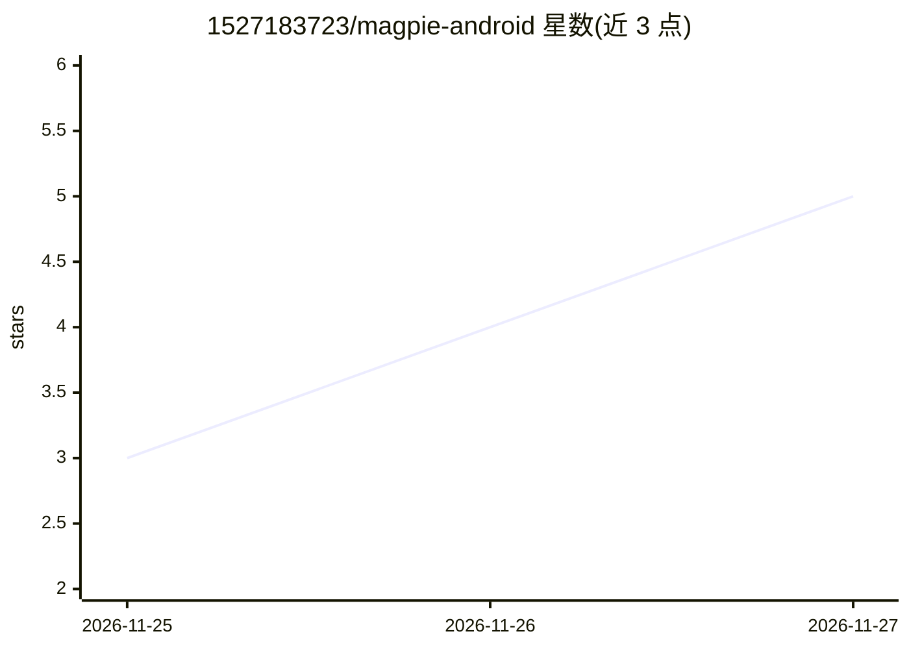

# 1527183723/magpie-android

⭐ 5 · Go · MIT · 推送 2026-11-21 · [GitHub](https://github.com/1527183723/magpie-android) · 个人维护 · 中文 README

**把 magpie LLM 网关移植成 Android APK 供手机 agent 接入**

非官方的 yetone/magpie Android 移植：在 APK 前台服务中运行 magpie 网关，默认监听 127.0.0.1:3425，为手机上的 agent 提供统一 base URL；WebView 打开 magpie 原有的供应商、账号、模型、路由组、插件与设置页面。支持局域网监听、开机自启、内置 Bun 插件运行时与应用内检查更新。需 Android 16+，构建需 JDK 21、Go、Android SDK/NDK，产物为 arm64/x86_64 APK。

## 筛选速览

| 维度 | 判定 | 备注 |
|---|---|---|
| AI 角色 | `ai-ecosystem` | LLM/agent 周边工具 |
| 许可风险 | `permissive` | MIT |
| 部署形态 | `None` |  |
| 模型依赖 | — | README 未给出锁定关系 |
| 硬件要求 | — | 无带数字的原话,不猜 |
| 安装摩擦 | `medium` | 含编译或系统依赖之一 |
| 成熟度 | — | 结构信号不足 |

## 能力要点

- 前台服务中运行 magpie 网关，进程退出后按退避自动重启
- 完整打包 magpie 网页界面，管理供应商、模型、路由组与插件
- 内置 Bun 1.4.5 Android 构建作为插件运行时，可选 --no-bun 裁剪
- 支持应用内检查更新与固定签名密钥的覆盖安装

## 适用场景

- 在手机上运行本地 LLM 网关给移动端 agent 用
- 统一管理多个模型供应商账号与路由组
- 局域网内让其他设备访问手机上的网关

## 场景标签

`模型网关` · 领域:Agent 开发

## 证据(README 行号)

> L3: 把 yetone/magpie 的网关和网页界面装进一个 Android APK：网关在应用的前台服务里运行，WebView 打开 magpie 自己的页面，手机上的 agent 通过 `http://127.0.0.1:3425/
> L29: - **一个本地网关**：默认监听 `127.0.0.1:3425`，给 Claude Code、Codex、Gemini CLI 等 agent 当统一 base URL。
> L30: - **完整网页界面**：magpie 自己的供应商、账号、模型、路由组、插件和设置页面都在 APK 里，首次启动自动打开。

## 星数曲线

2026-11-25 3 → 2026-11-27 5（+2）

---
*卡片 v1 · prompt 1.4 · 生成 2026-11-24 · 置信度 high · 依据 README sha `7b06ad5df325` · [字段定义](../../DATASET.md)*
