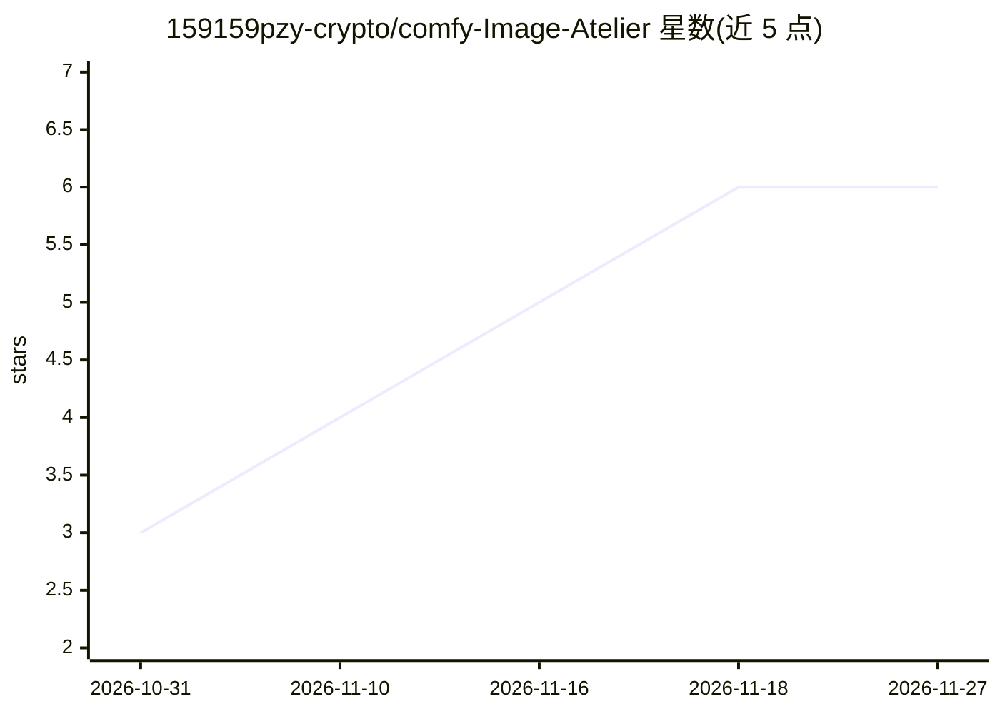

# 159159pzy-crypto/comfy-Image-Atelier

⭐ 6 · Python · MIT · 推送 2026-11-26 · [GitHub](https://github.com/159159pzy-crypto/comfy-Image-Atelier) · 个人维护 · 中文 README

**基于 ComfyUI 的本地 AI 生图工作台**

基于 ComfyUI 与 Anima Tools 生态构建的本地生图工作台，覆盖 Anima 与 Krea 2 两种模型档案。功能包括五池（角色/服装/姿势/背景/表情）随机批量抽取（每批最多 1000 张）、单图编辑与图生图、提示词反推（元数据/视觉 AI/本地标签三种）、提示词扩写、LoRA 管理、多阶段放大修复流程与作品历史管理。配套 Windows 启动器负责环境准备、模型下载、服务管理与更新。面向希望在本地批量出图与精细调图的用户。

## 筛选速览

| 维度 | 判定 | 备注 |
|---|---|---|
| AI 角色 | `ai-native` | 本体是模型或模型工具 |
| 许可风险 | `permissive` | MIT |
| 部署形态 | `desktop` | 安装包/桌面程序 |
| 模型依赖 | local-ok | 支持本地模型 |
| 硬件要求 | — | 无带数字的原话,不猜 |
| 安装摩擦 | `medium` | 含编译或系统依赖之一 |
| 成熟度 | — | 结构信号不足 |

## 能力要点

- 五池随机抽取，每批 1–1000 张、最多 20 个排队任务
- 三种提示词反推方式：图片元数据、视觉 AI、本地标签（八种预设模型方案）
- v5 放大修复流程：像素高清、潜空间放大、整图后采样、脸部细化、SeedVR2、VSR、DLSS 阶段串联
- Windows 启动器负责环境准备、模型下载与服务管理

## 适用场景

- 固定喜欢的角色与画风，批量抽取动作、服装、场景组合
- 拖入参考图做图生图，逐步调整单张画面
- 反推已有图片的提示词并继续创作
- 导入已有 ComfyUI 环境，统一管理模型与服务

## 场景标签

`提示工程` `图像生成` · 领域:Agent 开发

## 证据(README 行号)

> L5:  Anima 与 Krea 2 的本地生图工作台
> L20: Comfy Image Atelier 基于 ComfyUI 与 Anima Tools 生态构建，把提示词池、单图编辑、图生图、AI 提示词工具、LoRA、放大修复和作品历史放进同一个工作台。配套原生 Windows 启动器，负

## 星数曲线

2026-10-31 3 → 2026-11-27 6（+3）

---
*卡片 v1 · prompt 1.4 · 生成 2026-11-20 · 置信度 mid · 依据 README sha `10d1237cc778` · [字段定义](../../DATASET.md)*
