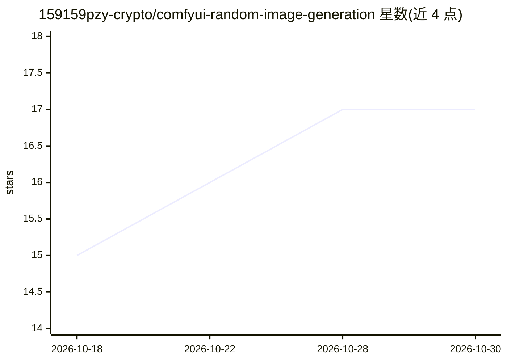

# 159159pzy-crypto/comfyui-random-image-generation

⭐ 17 · Python · MIT · 推送 2026-10-29 · [GitHub](https://github.com/159159pzy-crypto/comfyui-random-image-generation) · 个人维护 · 中文 README

**本地 AI 生图工作台：ComfyUI 上做 Anima/Krea 2 随机批量与单图创作**

基于 ComfyUI 与 Anima Tools 生态的 Windows 本地生图工作台，面向 ACG 创作用户。核心是五池随机抽取（角色/服装/姿势/背景/表情）批量生图（每批最多 1000 张）、单图编辑与图生图、提示词助手（OpenAI 兼容服务或 Ollama）、三种反推方式（元数据/视觉 AI/本地标签 WDTimmTagger）、LoRA 管理与放大修复链路、作品历史复现。配套 WinUI 3 启动器负责环境准备、模型下载（ModelScope/HF 镜像）、服务管理与更新。注意：项目已迁移更名为 Comfy Image Atelier，本仓库保留历史代码；当前 1.4.0 beta，收藏功能暂不推荐使用。

## 筛选速览

| 维度 | 判定 | 备注 |
|---|---|---|
| AI 角色 | `ai-native` | 本体是模型或模型工具 |
| 许可风险 | `permissive` | MIT |
| 部署形态 | `desktop` | 安装包/桌面程序 |
| 模型依赖 | local-ok | 支持本地模型 |
| 硬件要求 | — | 无带数字的原话,不猜 |
| 安装摩擦 | `medium` | 含编译或系统依赖之一 |
| 成熟度 | `idea` | |

## 能力要点

- 五池随机批量生成，每批 1–1000 张、最多 20 个排队任务
- 提示词助手支持 OpenAI 兼容服务与 Ollama，另提供元数据/视觉 AI/本地标签三种反推
- WinUI 3 启动器：六步向导、导入现有 ComfyUI、断点续传下载与 SHA-256 校验
- 作品历史支持复现此图、同词变体、重抽指定内容与按配置再抽

## 适用场景

- 固定喜欢的角色画风，批量随机探索动作、服装与场景组合
- 从已有图片反推提示词后做图生图继续创作
- 已有 ComfyUI 环境，导入后统一管理模型、服务与更新
- 把满意的参数组合存成风格预设反复使用

## 场景标签

`图像生成` · 领域:内容生成

## 证据(README 行号)

> L11:  Anima 与 Krea 2 的本地生图工作台
> L26: Anima Random Studio 基于 ComfyUI 与 Anima Tools 生态构建，把提示词池、单图编辑、图生图、AI 提示词工具、LoRA、放大修复和作品历史放进同一个工作台。配套原生 Windows 启动器，负

## 星数曲线

2026-10-18 15 → 2026-10-30 17（+2）

---
*卡片 v1 · prompt 1.4 · 生成 2026-10-30 · 置信度 high · 依据 README sha `ef8d2da00bdb` · [字段定义](../../DATASET.md)*
