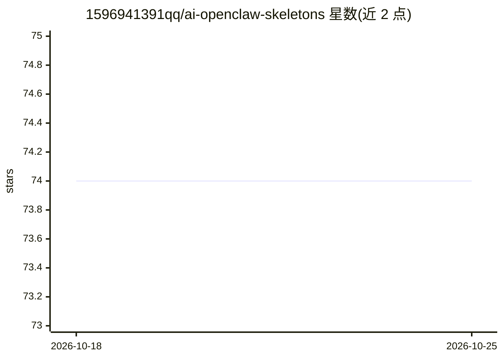

# 1596941391qq/ai-openclaw-skeletons

⭐ 74 · JavaScript · MIT · 推送 2026-05-18 · [GitHub](https://github.com/1596941391qq/ai-openclaw-skeletons) · 个人维护 · 中文 README

**面向 AI Agent 的可插拔数字员工骨架系统**

将 Pack/Bundle/Orchestrator/Contracts/Hooks 组织成可治理、可审计的常驻 agent 基础设施：Pack 是最小能力单元，Bundle 打包职责，Orchestrator 负责编排，Contracts 提供全局规则，Hooks 提供权限/审批/预算等治理插槽。附带 7 个基础设施 Pack（审计、意图路由、Hook 执行、上下文预热、定时调度、Token 监控等）、STOP 可观测能力（Manifest/Trace/Assertions）、Memory Bus 通信 schema 与 11 篇教程。通过 git clone 源码安装，运行在 OpenClaw Runtime 上（MIT 协议），公开仓不含私有业务流程。

## 筛选速览

| 维度 | 判定 | 备注 |
|---|---|---|
| AI 角色 | `ai-ecosystem` | LLM/agent 周边工具 |
| 许可风险 | `permissive` | MIT |
| 部署形态 | `None` |  |
| 模型依赖 | — | README 未给出锁定关系 |
| 硬件要求 | — | 无带数字的原话,不猜 |
| 安装摩擦 | `low` | 无编译、无系统依赖或容器化 |
| 成熟度 | — | 结构信号不足 |

## 能力要点

- Pack/Bundle/Orchestrator/Contracts/Hooks 五层组织结构
- 7 个基础设施 Pack（审计、路由、调度、Token 监控等）
- STOP 协议可观测：结构化 Trace、断言与会话报告输出到 jsonl/json 文件
- Memory Bus JSON schema 支持 Pack 间事件通信

## 适用场景

- 为常驻 AI agent 搭建带权限审批与审计的运行骨架
- 组合多个 Pack/Bundle 形成可替换的多 agent 编排
- 追踪 agent 工具调用链路与 Token 使用情况

## 场景标签

`Agent 框架` `多智能体` `LLM 可观测性` · 领域:Agent 开发

## 证据(README 行号)

> L5: 面向 AI Agent 的**可插拔数字员工骨架系统**。
> L7: 它不解决某一个单点能力，而是把 **Pack / Bundle / Orchestrator / Contracts / Hooks** 组织成一套可运行、可治理、可审计的常驻系统。

## 星数曲线

2026-10-18 74 → 2026-10-25 74（+0）

---
*卡片 v1 · prompt 1.4 · 生成 2026-10-24 · 置信度 high · 依据 README sha `8f9dad0f8d17` · [字段定义](../../DATASET.md)*
