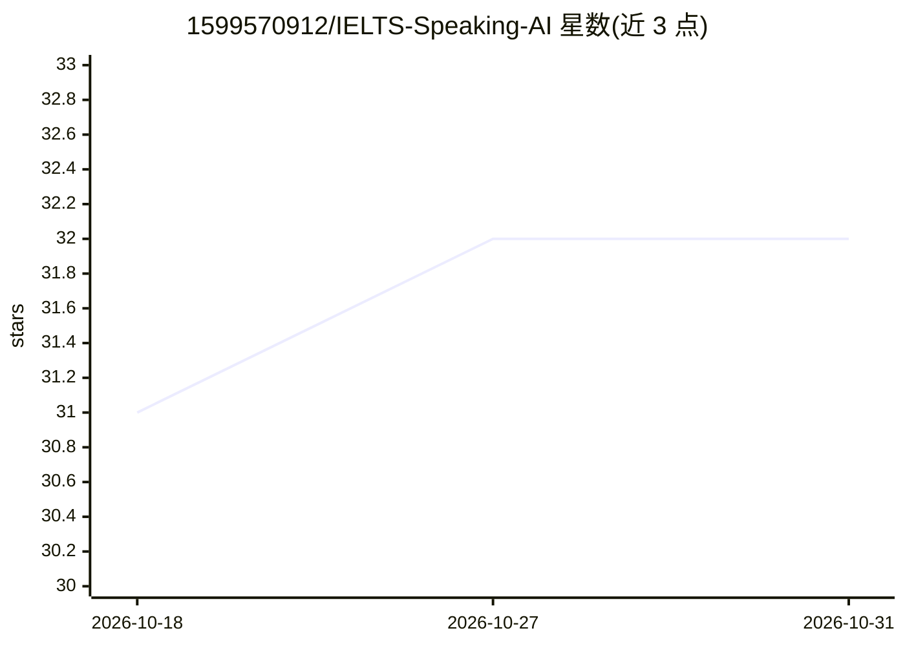

# 1599570912/IELTS-Speaking-AI

⭐ 32 · JavaScript · MIT · 推送 2026-07-28 · [GitHub](https://github.com/1599570912/IELTS-Speaking-AI) · [官网](https://1599570912.github.io/IELTS-Speaking-AI/ielts-speaking-app-ai.html) · 个人维护 · 中文 README

**浏览器端雅思口语练习应用：实时语音识别与四维评分**

面向非英语母语学习者的开源 Web 应用，用于练习雅思口语 Part 1–3：录音、Web Speech API 实时转录、基于雅思官方标准的流畅度/词汇/语法/发音四维评分（1-9 分），内置 210+ 道真题与本地历史记录。技术栈为 HTML/JS + MediaRecorder + IndexedDB，数据全部本地存储，支持 PWA 安装与离线录音，无需安装即可在浏览器使用；仓库另含实验性语言学习原型、内容管线及 scripts/ 下可选的 OpenAI 角色扮演提供方脚本。由个人开发者（中国石油大学华东）维护，MIT 协议。

## 筛选速览

| 维度 | 判定 | 备注 |
|---|---|---|
| AI 角色 | `ai-native` | 本体是模型或模型工具 |
| 许可风险 | `permissive` | MIT |
| 部署形态 | `None` |  |
| 模型依赖 | — | README 未给出锁定关系 |
| 硬件要求 | — | 无带数字的原话,不猜 |
| 安装摩擦 | `low` | 无编译、无系统依赖或容器化 |
| 成熟度 | — | 结构信号不足 |

## 能力要点

- Web Speech API 实时语音转录与基于雅思官方标准的四维评分
- 210+ 道题、90+ 话题，覆盖 Part 1/2/3 与综合练习
- 数据全部本地存储（IndexedDB/localStorage），支持 PWA 与离线录音

## 适用场景

- 备考雅思口语时按 Part/话题分类练习并获得评分反馈
- 跟踪练习历史与薄弱话题进度
- 不安装软件、在浏览器中直接进行口语练习

## 场景标签

`语音识别` · 领域:感知与多模态

## 证据(README 行号)

> L8: > 🤖 AI-powered IELTS speaking practice — real-time speech recognition, rubric-style scoring, 210+ questions, and loc
> L21: - **🗣️ 实时语音识别** - Web Speech API实时转录
> L22: - **🤖 AI智能评分** - 基于IELTS官方标准的四维评分

## 星数曲线

2026-10-18 31 → 2026-10-31 32（+1）

---
*卡片 v1 · prompt 1.4 · 生成 2026-10-26 · 置信度 high · 依据 README sha `e8d2b443964b` · [字段定义](../../DATASET.md)*
