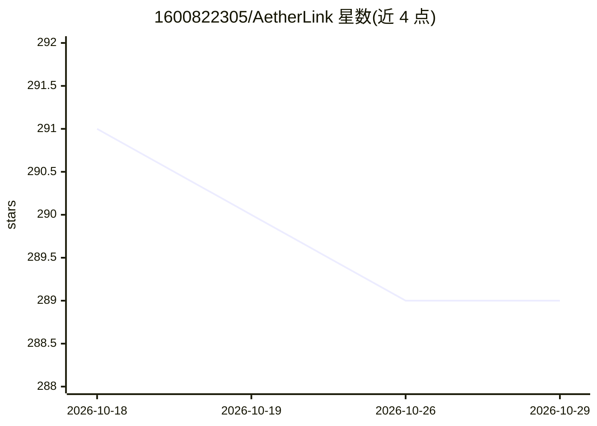

# 1600822305/AetherLink

⭐ 289 · TypeScript · NOASSERTION · 推送 2026-07-01 · [GitHub](https://github.com/1600822305/AetherLink) · 个人维护 · 中文 README

**跨平台 AI 助手应用：聚合多家模型进行对话、语音与知识库问答**

基于 React 19/TypeScript/Capacitor/Tauri 的跨平台 AI 助手客户端，覆盖 Android、iOS 与桌面端。支持 OpenAI、Claude、Gemini、Grok、硅基流动、火山方舟及自定义 API 端点，API 密钥在应用内配置；功能含语音识别与 TTS、MCP 工具集成、知识库文档上传与语义检索、AI 思考过程可视化。桌面端构建需要 Rust/Tauri，采用分层许可（≤8 人 AGPL，更大组织需商业许可）。

## 筛选速览

| 维度 | 判定 | 备注 |
|---|---|---|
| AI 角色 | `ai-native` | 本体是模型或模型工具 |
| 许可风险 | `none` | NOASSERTION |
| 部署形态 | `library` | 以包/库形式分发 |
| 模型依赖 | locked-api |  |
| 硬件要求 | — | 无带数字的原话,不猜 |
| 安装摩擦 | `low` | 无编译、无系统依赖或容器化 |
| 成熟度 | — | 结构信号不足 |

## 能力要点

- 多模型接入：OpenAI/Claude/Gemini/Grok/硅基流动/火山方舟及自定义 API
- 语音交互：Whisper 等识别 + Azure/OpenAI/硅基流动 TTS
- MCP 工具集成与知识库语义检索
- Capacitor + Tauri 双框架覆盖 Android/iOS/桌面

## 适用场景

- 在同一应用内切换使用多家 AI 模型对话
- 上传文档建立个人知识库做智能检索问答
- 在手机或桌面端通过语音与 AI 交互并使用 MCP 工具

## 场景标签

`AI 助手` `聊天机器人` `文档问答` · 领域:对话与助手

## 证据(README 行号)

> L14: AetherLink is a modern cross-platform AI assistant application built with cutting-edge web technologies. It support
> L18: - **Multi-Model Support** — OpenAI, Claude, Gemini, Grok, SiliconFlow, Volcengine, and custom API endpoints
> L100: AetherLink 是一款基于现代 Web 技术构建的跨平台 AI 助手应用。支持多种 AI 服务商（OpenAI、Google Gemini、Anthropic Claude、Grok、硅基流动、火山方舟等），在 Andro

## 星数曲线

2026-10-18 291 → 2026-10-29 289（-2）

---
*卡片 v1 · prompt 1.4 · 生成 2026-10-22 · 置信度 mid · 依据 README sha `b2605eda97f3` · [字段定义](../../DATASET.md)*
