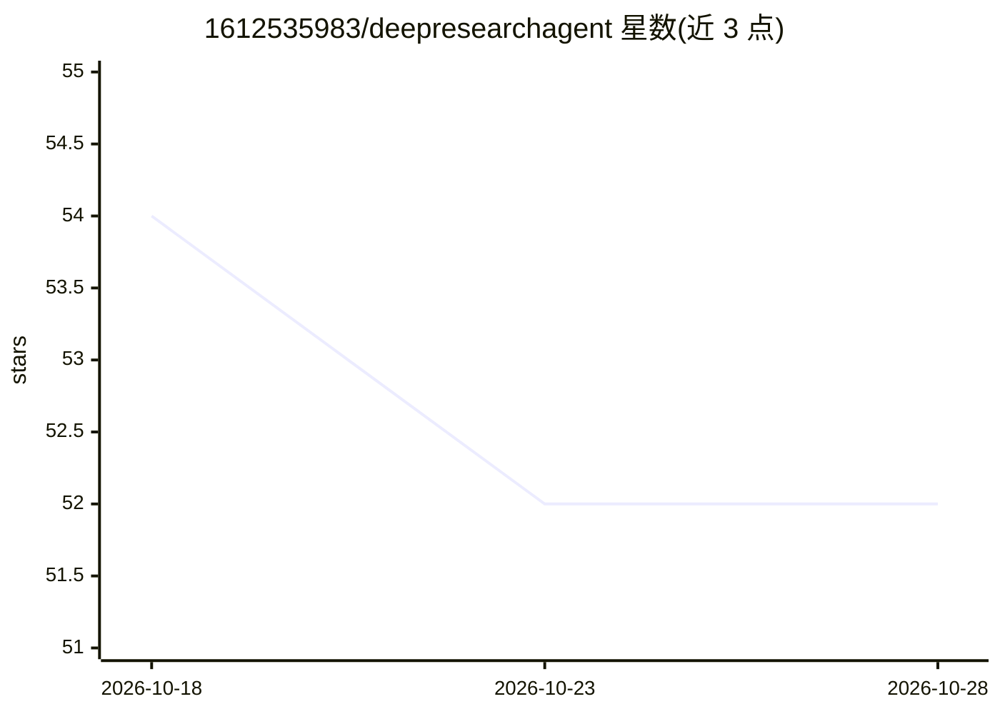

# 1612535983/deepresearchagent

⭐ 52 · Python · MIT · 推送 2026-09-27 · [GitHub](https://github.com/1612535983/deepresearchagent) · 个人维护 · 中文 README

**基于 LangGraph 的可恢复可审计深度研究 Agent，兼作学习参考**

从自然语言问题出发的深度研究智能体：自动规划研究、搜索并读取网页、聚合证据、校验引用，最终生成带来源的 Markdown 报告。通过 SQLite Checkpoint 支持按 thread_id 中断恢复；程序记录真实工具调用与上下文形成审计轨迹，并用 Token 治理、搜索/阅读预算和强制收尾控制长任务边界。模型经 OpenAI 兼容协议接入（默认示例 DeepSeek），提供 CLI、Python API 与本地 Web 工作台，另含 Skill 复用、Memory、概率评估与受控 Skill 演化。单 Agent、本地单用户，无登录与权限隔离。

## 筛选速览

| 维度 | 判定 | 备注 |
|---|---|---|
| AI 角色 | `ai-native` | 本体是模型或模型工具 |
| 许可风险 | `permissive` | MIT |
| 部署形态 | `None` |  |
| 模型依赖 | — | README 未给出锁定关系 |
| 硬件要求 | — | 无带数字的原话,不猜 |
| 安装摩擦 | `low` | 无编译、无系统依赖或容器化 |
| 成熟度 | — | 结构信号不足 |

## 能力要点

- 计划-搜索-证据-报告研究闭环，引用经来源校验
- SQLite Checkpoint 按 thread_id 中断恢复
- 真实 Tool 调用与上下文的审计记录，不依赖模型自述
- 332 个自动化测试与分阶段代码阅读路线

## 适用场景

- 输入开放问题获得带来源与执行记录的研究报告
- 研究长任务中断后通过 thread_id 恢复
- AI Agent 学习者按阶段阅读理解 Agent 工程结构

## 场景标签

`科研工具` · 领域:学习与行业

## 证据(README 行号)

> L7: 从自然语言问题出发，自动规划研究、搜索并读取网页、整理证据，最终生成带来源的 Markdown 报告。既可以通过 CLI 使用，也可以在 Web 工作台中实时观察研究过程。
> L18: DeepResearchAgent 是一个基于 LangGraph 构建的深度研究 Agent。
> L29: |**使用者**|输入一个开放问题，获得带来源的研究回答、执行记录和可选 Markdown 报告|

## 星数曲线

2026-10-18 54 → 2026-10-28 52（-2）

---
*卡片 v1 · prompt 1.4 · 生成 2026-10-24 · 置信度 high · 依据 README sha `601e0bd76ef2` · [字段定义](../../DATASET.md)*
