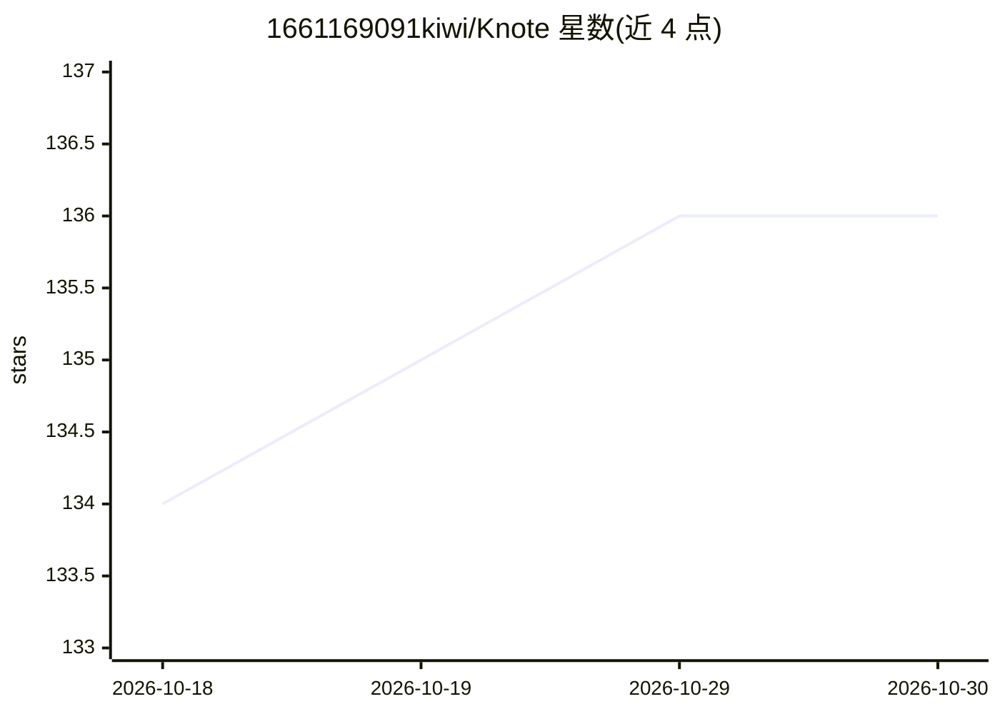

# 1661169091kiwi/Knote

⭐ 136 · JavaScript · MIT · 推送 2026-10-21 · [GitHub](https://github.com/1661169091kiwi/Knote) · [官网](https://1661169091kiwi.github.io/Knote/) · 个人维护 · 中文 README

**本地优先 Markdown 编辑器，内置可逐块审改的 AI 助手**

基于 TipTap/ProseMirror 与 Electron/Capacitor 的所见即所得 Markdown 编辑器，飞书/Notion 风格块编辑，以纯 Markdown 为唯一数据源。用户自带 API Key，接入 OpenAI 兼容或 Anthropic 接口配置 AI 助手；助手可读写当前文档、管理整个文件夹工作区（全库检索、建删改文件、并发批处理）、本地结构化 PDF、多引擎搜索与 OpenAlex/Crossref 论文检索。所有修改以红绿 diff 暂存，用户逐块或一键接受/拒绝。密钥仅存本地浏览器存储，无中转服务器。提供 Windows 安装包与 Android apk（测试中）。

## 筛选速览

| 维度 | 判定 | 备注 |
|---|---|---|
| AI 角色 | `ai-enhanced` | 去掉 AI 部分产品仍成立 |
| 许可风险 | `permissive` | MIT |
| 部署形态 | `desktop` | 安装包/桌面程序 |
| 模型依赖 | locked-api |  |
| 硬件要求 | — | 无带数字的原话,不猜 |
| 安装摩擦 | `low` | 无编译、无系统依赖或容器化 |
| 成熟度 | `idea` | |

## 能力要点

- AI 修改以红绿 diff 暂存，逐块或一键接受/拒绝，不直接覆盖原文
- AI 可管理整个文件夹工作区：全库检索、文件增删改、多文件并发批处理
- 桌面版本地结构化 PDF（文字、图表与图注提取），可选 PaddleOCR 一键安装增强
- 工作区面板实时展示计划、工具调用与子任务进度

## 适用场景

- 写作时让 AI 续写、润色并逐块审核修改
- 把 PDF 教材或论文拖入生成复习资料、大纲或总结
- 打开项目文件夹做跨文件知识库问答与批量文档整理
- 日常 Markdown 笔记编辑、导出 PDF/Word/HTML

## 场景标签

`AI 助手` `知识库管理` `文档问答` `文档解析` · 领域:对话与助手

## 证据(README 行号)

> L17: Knote 是一款本地优先的 Markdown 编辑器，拥有现代块编辑器（飞书 / Notion 风格）的顺滑体验，同时可配置辅助 Agent，他可以帮助你维护、修改、重构文档，你可以审改他的修改，不满意的内容可以拒绝修改。可作为
> L36: Knote 内置 AI 助手，直接驻守在编辑器中，目标是帮你把"写、改、审、理"文档这件事变得更顺手。他不会直接修改原文，而是先把改动暂存成 diff，用户逐块或一键接受后才会生效。
> L134: Knote is a local-first Markdown editor that feels like a modern block editor (Feishu / Notion style) while keeping

## 星数曲线

2026-10-18 134 → 2026-10-30 136（+2）

---
*卡片 v1 · prompt 1.4 · 生成 2026-10-22 · 置信度 high · 依据 README sha `7829159b92f6` · [字段定义](../../DATASET.md)*
