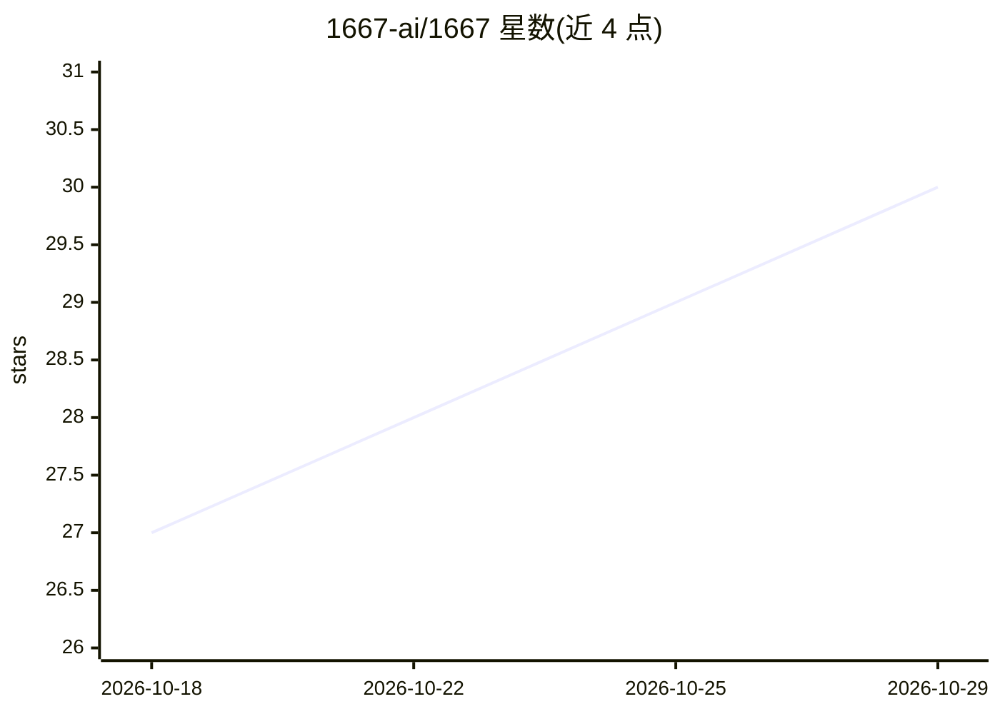

# 1667-ai/1667

⭐ 30 · TypeScript · Apache-2.0 · 推送 2026-10-06 · [GitHub](https://github.com/1667-ai/1667) · [官网](https://1667.ai) · 组织维护

**终端全屏小说写作工具：分支叙事+可选 LLM 续写**

全屏终端应用（TUI），用于创作分支小说：撰写故事片段、保留多个备选版本（takes）、选择要阅读的故事线；可选连接语言模型生成散文，也可完全手写。仓库含 TUI、Web UI 与后端，运行 `1667 web` 可在浏览器中写作。支持 SillyTavern 迁移与导入（含角色卡）、NovelAI 迁移与生成配置转移。macOS/Linux 用 Shell 安装器，Windows x64 用 PowerShell 安装器，许可证为 Apache 2.0。

## 筛选速览

| 维度 | 判定 | 备注 |
|---|---|---|
| AI 角色 | `ai-native` | 本体是模型或模型工具 |
| 许可风险 | `permissive` | Apache-2.0 |
| 部署形态 | `desktop` | 安装包/桌面程序 |
| 模型依赖 | — | README 未给出锁定关系 |
| 硬件要求 | — | 无带数字的原话,不猜 |
| 安装摩擦 | `low` | 无编译、无系统依赖或容器化 |
| 成熟度 | — | 结构信号不足 |

## 能力要点

- 分支叙事：保留备选 takes 并选取故事线
- 可选连接语言模型生成散文，也可无模型纯手写
- 同一仓库含 TUI、Web UI 与后端
- 提供 SillyTavern/NovelAI 迁移与角色卡导入

## 适用场景

- 我想在终端里写分支小说并保留多个备选情节
- 想让本地或远端 LLM 按方向续写故事片段
- 从 SillyTavern 或 NovelAI 迁移已有的角色与生成配置

## 场景标签

`AI 写作` · 领域:内容生成

## 证据(README 行号)

> L9: 1667 is a full-screen terminal app for fiction writing. Write story parts, keep
> L10: alternative takes, and select the story line that you want to read. Connect a

## 星数曲线

2026-10-18 27 → 2026-10-29 30（+3）

---
*卡片 v1 · prompt 1.4 · 生成 2026-10-26 · 置信度 high · 依据 README sha `07b87bb72d3b` · [字段定义](../../DATASET.md)*
