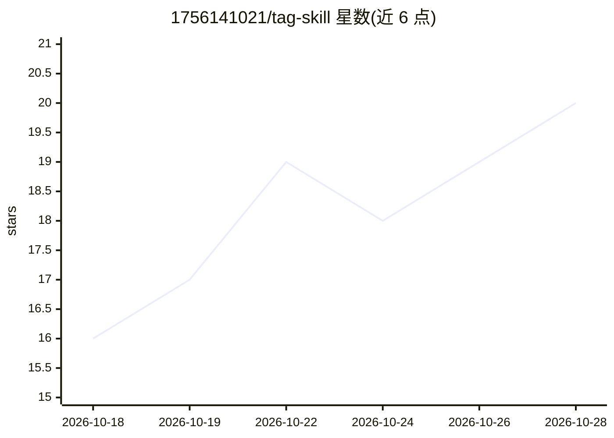

# 1756141021/tag-skill

⭐ 20 · MIT · 推送 2026-10-18 · [GitHub](https://github.com/1756141021/tag-skill) · 个人维护 · 中文 README

**给 AI 绘画玩家：生成适配各图像模型提示词的 agent skill**

面向 Claude Code 与 Pi agent 框架的提示词创作技能（SKILL.md 格式）：根据角色、动作、构图、环境与风格要求，生成适配 Stable Diffusion、NovelAI、Anima、Krea 2 的提示词，各平台有约定语法（A1111 权重、NAI 大括号权重、Krea 2 全中文等）。内置两份质量基线示例与 NAI 手册检索路由，支持自定义 OC 外貌库与创作上下文文件。安装方式为 git clone 到 skills 目录，无额外依赖。README 声明 Anima 与 Krea 2 格式未经系统验证。

## 筛选速览

| 维度 | 判定 | 备注 |
|---|---|---|
| AI 角色 | `ai-native` | 本体是模型或模型工具 |
| 许可风险 | `permissive` | MIT |
| 部署形态 | `None` |  |
| 模型依赖 | locked-api |  |
| 硬件要求 | — | 无带数字的原话,不猜 |
| 安装摩擦 | `low` | 无编译、无系统依赖或容器化 |
| 成熟度 | `idea` | |

## 能力要点

- 支持 SD / NovelAI / Anima / Krea 2 四种平台的提示词语法
- 含两份质量基线示例与 NAI 手册按需检索路由
- 支持自定义 OC 外貌库与长期创作上下文文件
- 无需额外依赖，git clone 到 skills 目录即用

## 适用场景

- 让 Claude 按我的角色和构图要求写 NovelAI/SD 提示词
- 保存自设角色外貌，长期沿用统一的创作风格
- 从参考图反推角色外貌后生成新构图提示词

## 场景标签

`提示工程` `图像生成` · 领域:Agent 开发

## 证据(README 行号)

> L5: 用于创作 AI 绘画提示词的 skill。根据角色、动作、构图、环境和风格要求，生成适合不同图像模型的提示词。
> L78: ### Stable Diffusion（SD）

## 星数曲线

2026-10-18 16 → 2026-10-28 20（+4）

---
*卡片 v1 · prompt 1.4 · 生成 2026-10-28 · 置信度 high · 依据 README sha `ab9a7f9152ad` · [字段定义](../../DATASET.md)*
