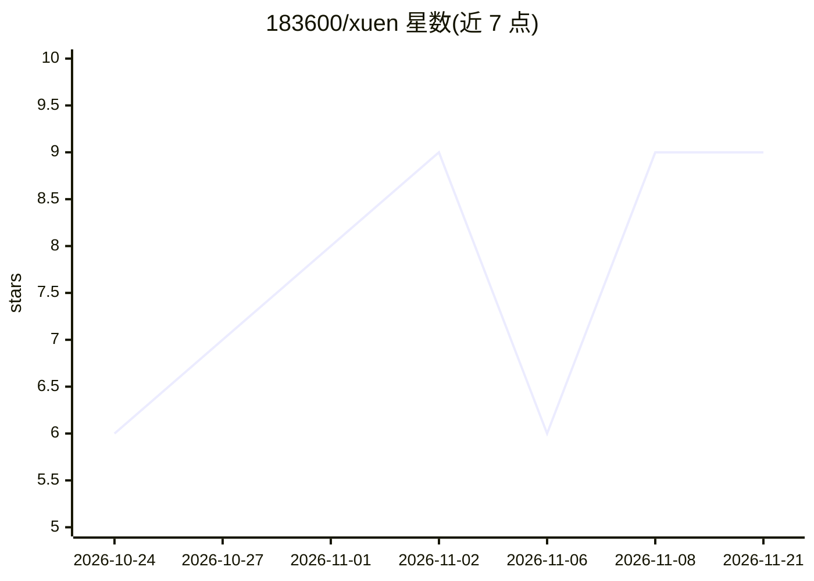

# 183600/xuen

⭐ 9 · Python · MIT · 推送 2026-11-20 · [GitHub](https://github.com/183600/xuen) · 个人维护 · 中文 README

**研究者 TUI 工具：随机灵感词驱动外部 agent 迭代研究**

xuen 本身不调用任何 LLM，仅负责循环组织、状态持久化、TUI 展示与轮次守卫。工作流程为：从领域词库纯随机抽取灵感词，将任务、灵感词、想法区/产物区拼成提示词，交给由 agent.command 指定的外部 shell 命令（如 opencode）完成思考，并保存候选快照、按测试/用户评分/AI 评审等验证方式晋升「当前最佳」。面向想以迭代循环方式开展研究任务的用户，以 Python 命令行工具形式安装运行。

## 筛选速览

| 维度 | 判定 | 备注 |
|---|---|---|
| AI 角色 | `ai-ecosystem` | LLM/agent 周边工具 |
| 许可风险 | `permissive` | MIT |
| 部署形态 | `library` | 以包/库形式分发 |
| 模型依赖 | — | README 未给出锁定关系 |
| 硬件要求 | — | 无带数字的原话,不猜 |
| 安装摩擦 | `low` | 无编译、无系统依赖或容器化 |
| 成熟度 | — | 结构信号不足 |

## 能力要点

- 纯随机灵感词抽样不调用模型，思考全部交给外部 agent
- 轮次守卫机制：候选快照 + 测试/用户/AI 多种验证方式
- 想法区/产物区跨轮持久化于 research.md，重跑自动续用
- textual TUI 默认启用，不可用时自动降级为纯终端输出

## 适用场景

- 用随机术语组合触发外部 agent 的迭代式研究探索
- 研究循环中通过测试套件或用户评分守卫进度
- 需要审计日志与历史快照的长时间自动化循环

## 场景标签

`科研工具` · 领域:学习与行业

## 证据(README 行号)

> L12: > **注意**：xuen 本身不调用任何 LLM。所有思考由外部 agent 完成，xuen 只负责循环组织、状态持久化、TUI 展示与轮次守卫。
> L22: |外部 agent|由 `agent.command` 指定的 shell 命令，负责每轮的实际思考|
> L222: |只调用外部 agent|`ShellAgent`；词库也由外部 agent 生成|

## 星数曲线

2026-10-24 6 → 2026-11-21 9（+3）

---
*卡片 v1 · prompt 1.4 · 生成 2026-11-20 · 置信度 high · 依据 README sha `413937f6aa30` · [字段定义](../../DATASET.md)*
