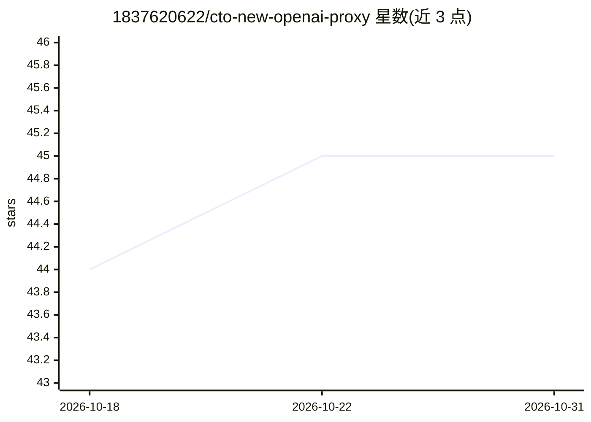

# 1837620622/cto-new-openai-proxy

⭐ 45 · Python · MIT · 推送 2026-04-18 · [GitHub](https://github.com/1837620622/cto-new-openai-proxy) · 个人维护 · 中文 README

**把 cto.new 免费模型反代成 OpenAI/Anthropic 兼容 API 的账号池代理**

Go 编写的反向代理：批量注册 cto.new（Engine Labs）免费账号，将其 GPT-5.4 / GLM-5.1 模型以 OpenAI /v1/chat/completions 和 Anthropic /v1/messages 兼容接口（流式与非流式、多模态输入）暴露。账号池采用 LRU 选择、Clerk __client cookie 自动刷新 JWT、配额/死号标记（6h 冷却）与 30 秒热加载；附 Playwright/Selenium 注册脚本与 Dashboard Web UI。限制：不支持 function calling / tool use（上游为独立 agent 端点），注册页有 Turnstile 风控，上游消息体约 32KB。

## 筛选速览

| 维度 | 判定 | 备注 |
|---|---|---|
| AI 角色 | `ai-ecosystem` | LLM/agent 周边工具 |
| 许可风险 | `permissive` | MIT |
| 部署形态 | `library` | 以包/库形式分发 |
| 模型依赖 | — | README 未给出锁定关系 |
| 硬件要求 | — | 无带数字的原话,不猜 |
| 安装摩擦 | `low` | 无编译、无系统依赖或容器化 |
| 成熟度 | — | 结构信号不足 |

## 能力要点

- OpenAI 与 Anthropic 双协议兼容接口（流式/非流式/多模态）
- 账号池 LRU 轮询 + Clerk JWT 自动刷新 + 30 秒热加载
- Playwright/Selenium 批量注册脚本与登录页 cookie 刷新器
- Dashboard Web UI 与 /status /admin 管理端点

## 适用场景

- 用 OpenAI/Anthropic 兼容客户端免费调用 GPT-5.4/GLM-5.1 做纯对话与代码生成
- 在 opencode/cline 中以 Plan 模式做只读讨论
- 快速测试 LLM 输出质量（无工具调用需求）

## 场景标签

`模型网关` · 领域:Agent 开发

## 证据(README 行号)

> L12: A Go reverse proxy that turns cto.new (Engine Labs) free chat models into standard **OpenAI** / **Anthropic** compa
> L15: - **Protocols**: OpenAI chat completions (stream + non-stream), Anthropic messages (stream + non-stream), multimoda

## 星数曲线

2026-10-18 44 → 2026-10-31 45（+1）

---
*卡片 v1 · prompt 1.4 · 生成 2026-10-25 · 置信度 mid · 依据 README sha `99e2dd977efb` · [字段定义](../../DATASET.md)*
