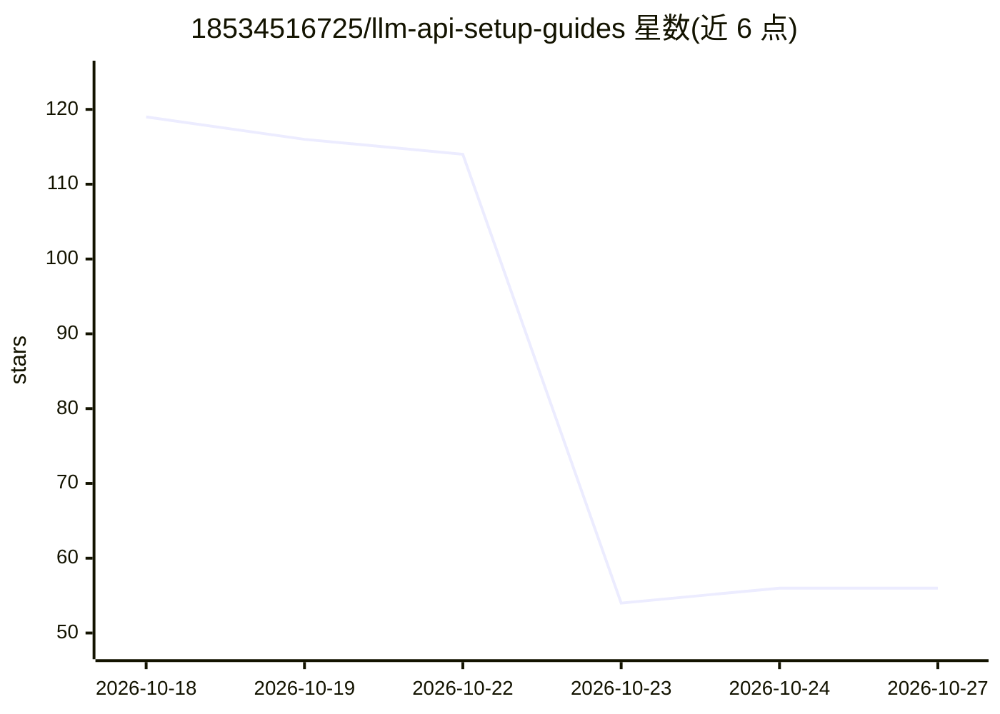

# 18534516725/llm-api-setup-guides

⭐ 56 · JavaScript · MIT · 推送 2026-10-21 · [GitHub](https://github.com/18534516725/llm-api-setup-guides) · [官网](https://18534516725.github.io/llm-api-setup-guides/) · 组织维护 · 中文 README

**139 篇中文教程：教你在各类工具中配置 AI API 中转与接入**

面向中文用户的 AI API 接入教程合集仓库：覆盖 99 款工具，包括聊天客户端（Cherry Studio、Chatbox 等）、AI 编程工具（Claude Code、Codex CLI、Cursor、Cline 等）、本地模型运行时（Ollama、vLLM、llama.cpp 等）、自部署知识库、开发框架与 API 测试工具。每篇教程包含安装、配置、首次验证、安全提醒与常见报错排查，按 OpenAI Chat Completions、OpenAI Responses 和 Anthropic Messages 三类公开协议编写。教程示例配套一个中转站服务（NexoToken/纽智中转站），并标注其免费额度与付费体验活动。

## 筛选速览

| 维度 | 判定 | 备注 |
|---|---|---|
| AI 角色 | `ai-knowledge` | 知识聚合/清单类 |
| 许可风险 | `permissive` | MIT |
| 部署形态 | `None` |  |
| 模型依赖 | — | README 未给出锁定关系 |
| 硬件要求 | — | 无带数字的原话,不猜 |
| 安装摩擦 | `low` | 无编译、无系统依赖或容器化 |
| 成熟度 | — | 结构信号不足 |

## 能力要点

- 139 篇中文文档，覆盖 99 款工具的 API 接入配置
- 每篇教程含安装、配置、首次验证、安全提醒与报错排查
- 按问题直达的排错手册：401/404/429/5xx、SSE、Docker、RAG 排错
- 提供在线中文文档站、GitHub 教程总目录与兼容性总表

## 适用场景

- 我在 Cherry Studio 或 Cursor 里不知道 API Key 和 Base URL 填哪，想找配置教程
- 我想用中转 API 接入 Claude Code / Codex CLI 写代码
- 配置报 401/404 等错误时按状态码逐项定位问题
- 选型前了解订阅、官方 API 与兼容 API 的区别

## 场景标签

`教程课程` · 领域:学习与行业

## 证据(README 行号)

> L29: **本仓库把主流 AI 工具的接入方式全部整理成统一格式的详细教程**:
> L89: > 当前共 **139 篇中文文档，覆盖 99 款工具、协议、平台与开发框架**。不知道选哪个？先打开支持站内搜索的 **在线中文文档站**，或查看 **GitHub 教程总目录** 和 **兼容性总表**。

## 星数曲线

2026-10-18 119 → 2026-10-27 56（-63）

---
*卡片 v1 · prompt 1.4 · 生成 2026-10-24 · 置信度 mid · 依据 README sha `d29d7286dbdb` · [字段定义](../../DATASET.md)*
