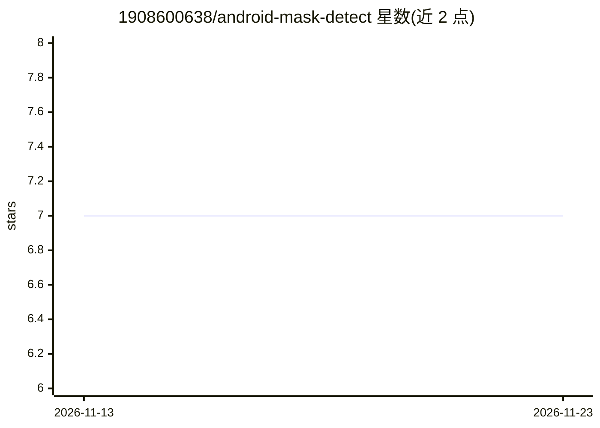

# 1908600638/android-mask-detect

⭐ 7 · C++ · Apache-2.0 · 推送 2026-11-11 · [GitHub](https://github.com/1908600638/android-mask-detect) · 个人维护 · 中文 README

**Android 口罩识别示例：CameraX 抓帧 + ncnn/YOLOv5 端侧检测**

Android 演示工程：CameraX 预览并抓取视频帧，经 JNI 调用 ncnn 推理框架运行 YOLOv5s 模型，一次检测多张人脸并标注是否佩戴口罩，输出带框图像与佩戴统计文本。推理与后处理（letterbox、anchor 解码、NMS、坐标还原）在 C++ 层实现，ncnn 静态库随仓库附带。构建需 Android Studio、NDK 23.1.7779620 与 CMake 3.10.2，仅编译 arm64-v8a，需 ARM64 真机运行。模型标注仅用于学习演示。

## 筛选速览

| 维度 | 判定 | 备注 |
|---|---|---|
| AI 角色 | `ai-native` | 本体是模型或模型工具 |
| 许可风险 | `permissive` | Apache-2.0 |
| 部署形态 | `None` |  |
| 模型依赖 | — | README 未给出锁定关系 |
| 硬件要求 | — | 无带数字的原话,不猜 |
| 安装摩擦 | `medium` | 含编译或系统依赖之一 |
| 成熟度 | — | 结构信号不足 |

## 能力要点

- ncnn 静态库随仓库附带，经 CMake 编译为 libyolov5ncnn.so，Java 层仅暴露 initMask/detectMask 两个 JNI 方法
- YOLOv5s 三尺度检测头（stride 8/16/32），letterbox 缩放与坐标还原保证框位置正确
- 一次检测多张人脸并汇总「共 N 张人脸，其中 M 张佩戴口罩」
- 类别名硬编码于 C++ 层，Java 直接输出中文标签

## 适用场景

- 在 Android 真机上体验端侧人脸口罩检测
- 学习 ncnn 与 JNI 在 Android 上的模型部署流程
- 参考 YOLOv5 后处理（letterbox/NMS/坐标还原）的 C++ 实现

## 场景标签

`目标检测` · 领域:感知与多模态

## 证据(README 行号)

> L6: - 一次可检测多张人脸，逐个人脸画框并标注是否戴口罩
> L23: 用的是**腾讯 ncnn**——一个为手机端优化的 C++ 推理框架，以静态库形式随仓库附带，通过 CMake 编译成 `libyolov5ncnn.so`。
> L106: |设备|ARM64 真机 + 摄像头|

## 星数曲线

2026-11-13 7 → 2026-11-23 7（+0）

---
*卡片 v1 · prompt 1.4 · 生成 2026-11-20 · 置信度 high · 依据 README sha `b8366814f4c3` · [字段定义](../../DATASET.md)*
