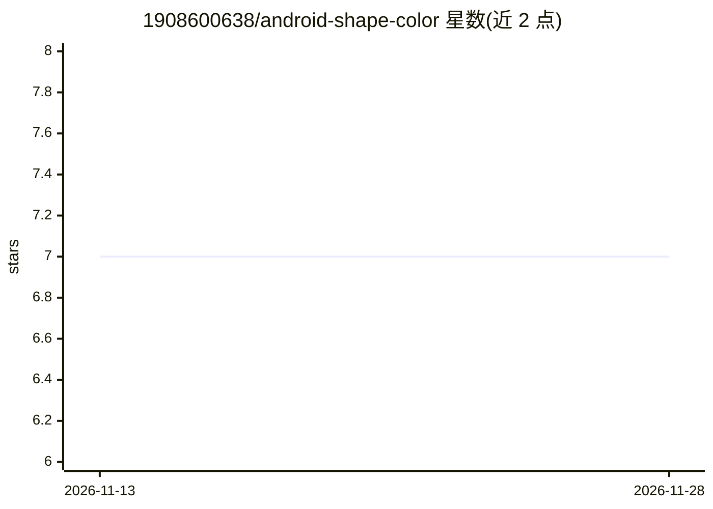

# 1908600638/android-shape-color

⭐ 7 · C++ · Apache-2.0 · 推送 2026-11-11 · [GitHub](https://github.com/1908600638/android-shape-color) · 个人维护 · 中文 README

**Android 端实时识别图形形状与颜色的示例应用**

基于 CameraX 与腾讯 ncnn 推理框架的 Android 示例工程，加载两个独立训练的 YOLOv5 模型分别识别 5 类形状和 8 类颜色，通过 IOU 大于 0.5 将形状框与颜色框配对输出「形状（颜色）」与置信度。Java 层经 JNI 调用 C++ 推理代码，包含 letterbox、解码、NMS 等完整 YOLOv5 后处理。需 Android Studio、NDK 23.1、CMake 3.10.2 编译，仅支持 arm64-v8a 真机，模型文件标注仅用于学习演示。

## 筛选速览

| 维度 | 判定 | 备注 |
|---|---|---|
| AI 角色 | `ai-native` | 本体是模型或模型工具 |
| 许可风险 | `permissive` | Apache-2.0 |
| 部署形态 | `None` |  |
| 模型依赖 | — | README 未给出锁定关系 |
| 硬件要求 | — | 无带数字的原话,不猜 |
| 安装摩擦 | `medium` | 含编译或系统依赖之一 |
| 成熟度 | — | 结构信号不足 |

## 能力要点

- 两个独立 YOLOv5 模型分别识别 5 类形状与 8 类颜色
- 以 IOU>0.5 配对形状框与颜色框
- ncnn 静态库随仓库附带，JNI 暴露 init/detect 四个方法
- 含 letterbox、anchor 解码、NMS 的完整 YOLOv5 后处理实现

## 适用场景

- 在 Android 手机上实时识别图形的形状与颜色
- 学习 YOLOv5 在 ncnn 端侧部署的完整流程
- 参考 JNI + CMake 集成 ncnn 模型的工程结构

## 场景标签

`目标检测` · 领域:感知与多模态

## 证据(README 行号)

> L8: - 摄像头实时预览，点「识别」抓取当前这一帧
> L9: - 一次可识别多个图形，每个图形输出「形状（颜色）」和置信度
> L46: 用的是**腾讯 ncnn**——为手机端优化的 C++ 推理框架，以静态库形式随仓库附带，通过 CMake 编译成 `libyolov5ncnn.so`。

## 星数曲线

2026-11-13 7 → 2026-11-28 7（+0）

---
*卡片 v1 · prompt 1.4 · 生成 2026-11-20 · 置信度 high · 依据 README sha `dd336b030de5` · [字段定义](../../DATASET.md)*
