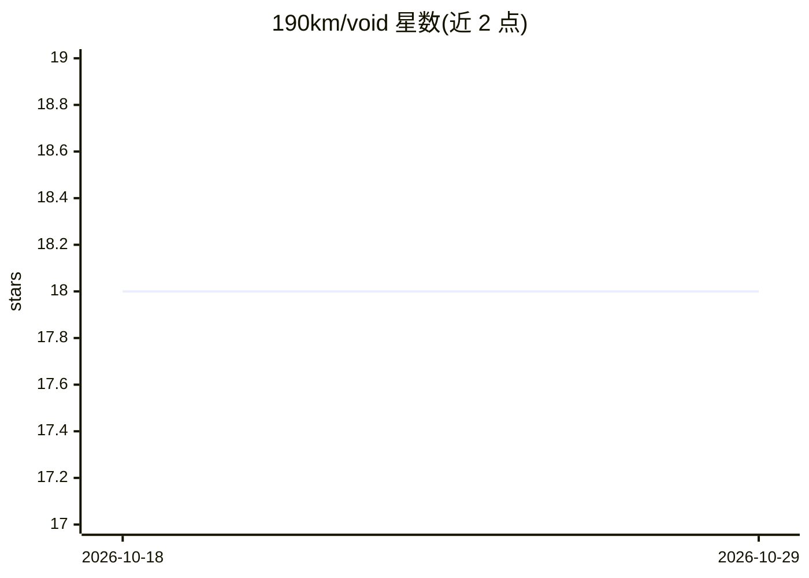

# 190km/void

⭐ 18 · Rust · MIT · 推送 2026-03-31 · [GitHub](https://github.com/190km/void) · 个人维护

**GPU 加速的无限画布终端模拟器，可自由摆放多个终端**

用 Rust 编写的跨平台（Windows/Linux/macOS）终端模拟器：在无限 2D 画布上以平移/缩放方式自由摆放、拖拽和缩放终端面板，每个面板是独立的 PTY 进程，终端仿真由 alacritty_terminal 提供（ANSI/VT100、256 色、真彩色）。渲染基于 wgpu（Vulkan/Metal/DX12），无 Electron/WebView。功能含工作区、命令面板、小地图、键盘优先操作。面向在画布中并行管理多个终端会话（如 Claude Code、Codex、OpenCode 等 agent 工作流）的开发者，从 Releases 下载二进制即可运行，无需构建。

## 筛选速览

| 维度 | 判定 | 备注 |
|---|---|---|
| AI 角色 | `ai-ecosystem` | LLM/agent 周边工具 |
| 许可风险 | `permissive` | MIT |
| 部署形态 | `desktop` | 安装包/桌面程序 |
| 模型依赖 | — | README 未给出锁定关系 |
| 硬件要求 | — | 无带数字的原话,不猜 |
| 安装摩擦 | `low` | 无编译、无系统依赖或容器化 |
| 成熟度 | — | 结构信号不足 |

## 能力要点

- 无限 2D 画布上任意摆放/拖拽/缩放终端面板
- wgpu GPU 加速 60fps 渲染（Vulkan/Metal/DX12）
- 基于 alacritty_terminal 的完整终端仿真，每面板为独立 PTY 进程
- 工作区、命令面板、小地图、全键盘操作

## 适用场景

- 在一个画布上并行管理多个终端会话，缩放查看全局或聚焦局部
- 为 Claude Code / Codex 等编码 agent 分配独立终端工作区
- 替代传统的标签页/分屏式终端布局

## 场景标签

 · 领域:开发者工具/终端

## 证据(README 行号)

> L5: Void is an infinite canvas terminal emulator — GPU-accelerated, cross-platform. No tabs, no splits, no tiling — just
> L9: - Real terminal emulation powered by alacritty_terminal (ANSI/VT100, 256-color, truecolor)
> L30: Each terminal panel is an independent PTY process rendered onto the canvas via the GPU. Panels can be freely dragge

## 星数曲线

2026-10-18 18 → 2026-10-29 18（+0）

---
*卡片 v1 · prompt 1.4 · 生成 2026-10-29 · 置信度 mid · 依据 README sha `866d8631011e` · [字段定义](../../DATASET.md)*
