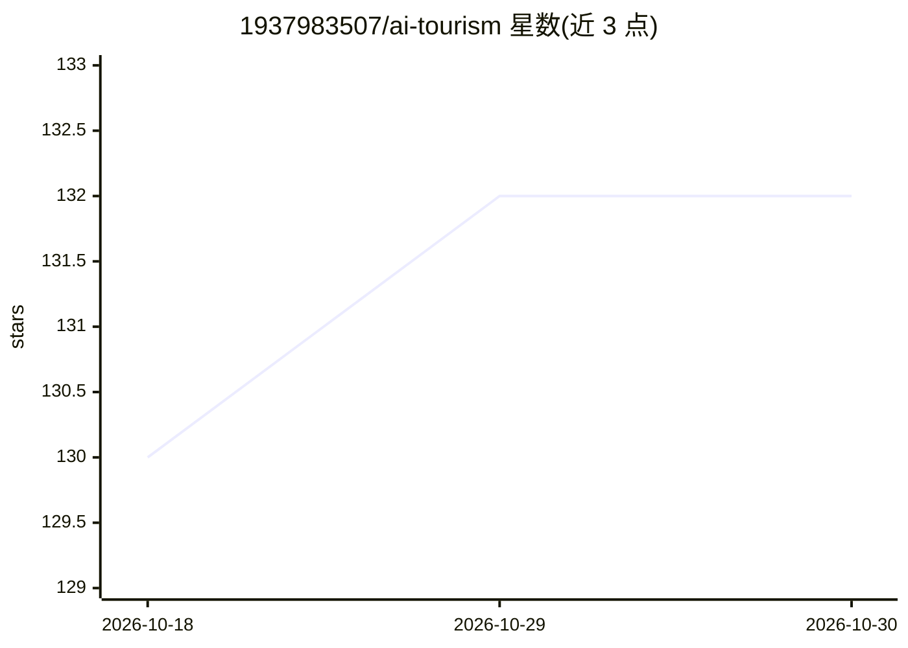

# 1937983507/ai-tourism

⭐ 132 · Java · 推送 2026-03-09 · [GitHub](https://github.com/1937983507/ai-tourism) · [官网](https://www.aitrip.chat/) · 个人维护 · 中文 README

**AI 旅游规划助手后端：多轮对话生成个性化路线**

基于 Spring Boot、LangChain4j、MySQL、Redis 构建的智能旅游规划系统后端：用户以自然语言输入需求后，AI Agent 通过 MCP 工具与 Function Call 获取天气、景点等信息，经 SSE 流式返回文字攻略并基于 JSON Schema 输出结构化路线供前端地图渲染。支持多轮对话记忆（Redis 短期 + MySQL 长期）、Sa-Token 权限认证、Prometheus+Grafana 监控。README 注明本项目已停止维护，新版移步 ai-tourism-backend 等仓库；部署需 JDK 21、Maven、MySQL、Redis，从源码构建运行。

## 筛选速览

| 维度 | 判定 | 备注 |
|---|---|---|
| AI 角色 | `ai-native` | 本体是模型或模型工具 |
| 许可风险 | `none` | — |
| 部署形态 | `None` |  |
| 模型依赖 | — | README 未给出锁定关系 |
| 硬件要求 | — | 无带数字的原话,不猜 |
| 安装摩擦 | `medium` | 含编译或系统依赖之一 |
| 成熟度 | — | 结构信号不足 |

## 能力要点

- AI Agent 调用 MCP 工具与 Function Call 获取天气、景点信息并生成路线
- SSE 流式输出文字攻略 + JSON Schema 结构化路线供地图渲染
- Redis 短期记忆 + MySQL 会话历史的多轮对话与实例隔离
- MCP 工具热插拔与 ToolManager 统一注册

## 适用场景

- 用自然语言对话获取个性化旅游路线与图文攻略
- 学习 LangChain4j + MCP + Function Call 的 Java AI 应用工程实现
- 参考带权限认证与监控的 AI 对话后端架构

## 场景标签

`聊天机器人` · 领域:对话与助手

## 证据(README 行号)

> L36: **AI 智能旅游规划系统**，结合 `SpringBoot` 与 `LangChain4j`，在用户输入自然语言后，由 **AI Agent** 调用 **MCP 工具**与 **Function Call** 获取天气、景点等
> L174: |`/ai_assistant/chat`|`POST`|发起 AI 流式对话，返回旅游路线建议|

## 星数曲线

2026-10-18 130 → 2026-10-30 132（+2）

---
*卡片 v1 · prompt 1.4 · 生成 2026-10-23 · 置信度 high · 依据 README sha `26ebefb8e5ed` · [字段定义](../../DATASET.md)*
