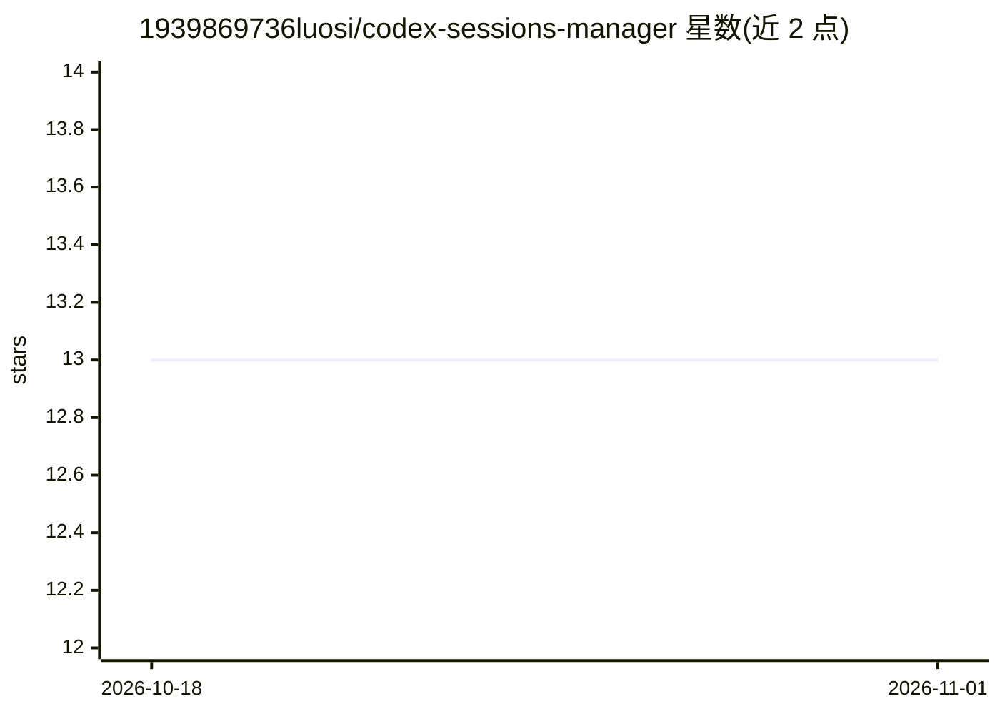

# 1939869736luosi/codex-sessions-manager

⭐ 13 · TypeScript · Apache-2.0 · 推送 2026-08-02 · [GitHub](https://github.com/1939869736luosi/codex-sessions-manager) · [官网](https://www.npmjs.com/package/codex-sessions-manager) · 个人维护 · 中文 README

**本地 Codex 会话审计/清理/恢复/核验的 CLI 与 MCP 工具**

面向 OpenAI Codex CLI 本地历史的 CLI-first 审计与恢复工具，CLI、Skill 与受限 MCP server 共用同一核心。功能包括核验官方 thread/delete 后的残留、清理遗留/损坏/孤儿状态、可恢复回收站与冲突安全还原、变更日志与回滚、删除后结构化核验，以及只读的会话家族关系检测。定位为官方 Codex 的补充而非替代：常规操作遵循官方优先。内存库 memories_N.sqlite 保持只读，记忆溯源验证为路线图工作。

## 筛选速览

| 维度 | 判定 | 备注 |
|---|---|---|
| AI 角色 | `ai-ecosystem` | LLM/agent 周边工具 |
| 许可风险 | `permissive` | Apache-2.0 |
| 部署形态 | `library` | 以包/库形式分发 |
| 模型依赖 | — | README 未给出锁定关系 |
| 硬件要求 | — | 无带数字的原话,不猜 |
| 安装摩擦 | `low` | 无编译、无系统依赖或容器化 |
| 成熟度 | — | 结构信号不足 |

## 能力要点

- 删除后 verify 核验文件、索引、全局状态与 SQLite 行的残留
- 持久化变更日志：可证明安全时回滚，否则标记 recovery_required 阻断后续写入
- 回收站/还原带 SQLite 键冲突检查，.jsonl.zst 以二进制安全方式保留
- 受限 MCP server 供 AI agent 执行审计、核验、恢复与显式批准的清理

## 适用场景

- 核验官方 Codex 删除后本地是否仍有残留
- 定期批量审计并预览清理遗留或损坏的会话状态
- 清理失败后安全回滚或显式恢复
- 让 AI agent 通过 MCP 做受限的本地会话审计

## 场景标签

`Agent 记忆` · 领域:Agent 开发

## 证据(README 行号)

> L10: **codex-sessions-manager** is a CLI-first local Codex history auditor and recovery tool. Its **Skill**, **CLI**, an
> L28: - bounded MCP access for AI agents;

## 星数曲线

2026-10-18 13 → 2026-11-01 13（+0）

---
*卡片 v1 · prompt 1.4 · 生成 2026-10-31 · 置信度 high · 依据 README sha `9b436134c32b` · [字段定义](../../DATASET.md)*
