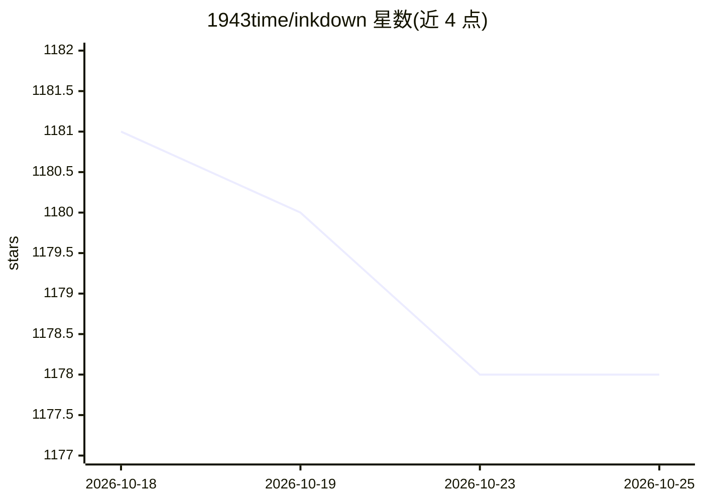

# 1943time/inkdown

⭐ 1,178 · TypeScript · AGPL-3.0 · 推送 2025-12-19 · [GitHub](https://github.com/1943time/inkdown) · 个人维护

**兼容 GFM 的所见即所得 Markdown 编辑器，内置 LLM 对话**

基于 Electron 的桌面 Markdown 编辑器，渲染与编辑完全兼容 GitHub Flavored Markdown Spec，同时内置 LLM 对话功能，可在写作过程中与模型交互。提供 macOS（Arm64/X64）与 Windows（Arm64/X64）构建，另有 VSCode 插件（通过 Marketplace 获取）。README 明确声明项目目前处于暂停状态，不再积极维护，选型时需注意该限制。

## 筛选速览

| 维度 | 判定 | 备注 |
|---|---|---|
| AI 角色 | `ai-enhanced` | 去掉 AI 部分产品仍成立 |
| 许可风险 | `viral` | AGPL-3.0 |
| 部署形态 | `None` |  |
| 模型依赖 | — | README 未给出锁定关系 |
| 硬件要求 | — | 无带数字的原话,不猜 |
| 安装摩擦 | `low` | 无编译、无系统依赖或容器化 |
| 成熟度 | — | 结构信号不足 |

## 能力要点

- 完全兼容 GitHub Flavored Markdown Spec 的所见即所得编辑
- 内置 LLM 对话功能
- 提供 macOS/Windows 双架构构建与 VSCode 插件

## 适用场景

- 本地撰写与管理 Markdown 笔记和文档
- 写作时直接调用 LLM 对话辅助内容产出
- 在 VSCode 中使用同款编辑能力

## 场景标签

`AI 写作` · 领域:内容生成

## 证据(README 行号)

> L3: ## Inkdown Editor is a WYSIWYG editor and an LLM dialogue tool, fully compatible with GitHub Flavored Markdown Spec.
> L9: |Mac|Windows|VsCode|

## 星数曲线

2026-10-18 1,181 → 2026-10-25 1,178（-3）

---
*卡片 v1 · prompt 1.4 · 生成 2026-10-23 · 置信度 mid · 依据 README sha `fbfa6e9bd657` · [字段定义](../../DATASET.md)*
