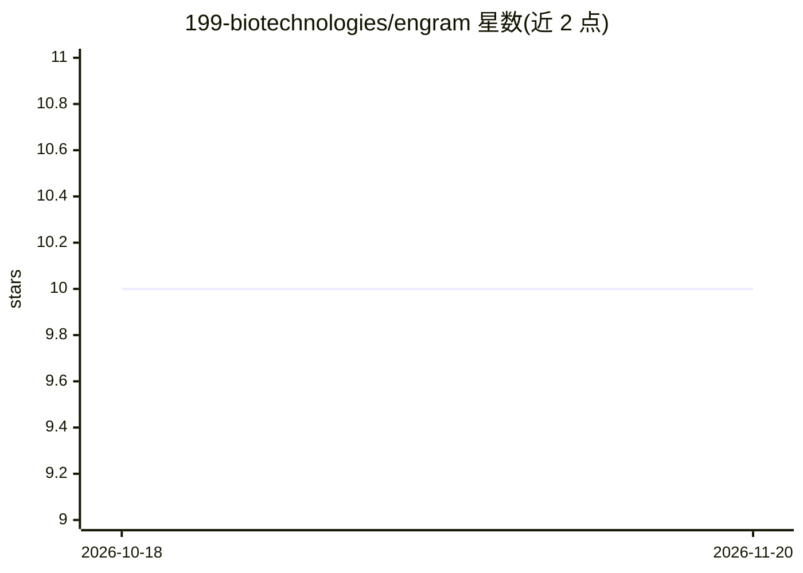

# 199-biotechnologies/engram

⭐ 10 · TypeScript · MIT · 推送 2026-04-17 · [GitHub](https://github.com/199-biotechnologies/engram) · 个人维护

**给 AI 客户端提供持久记忆的 MCP server**

基于 MCP 协议的 AI 记忆服务器：并行运行 BM25（SQLite FTS5）、语义嵌入（MongoDB LEAF 经 Transformers.js）与知识图谱三种检索，用 Reciprocal Rank Fusion 融合，再按 Ebbinghaus 遗忘曲线做时间衰减与显著性打分。提供 remember/recall/forget 等十余个 MCP 工具，含记忆整合（压缩旧记忆、检测矛盾）、可视化浏览器与 HTTP/stdio 双传输。本地存储于 ~/.engram/，核心功能离线可用，API key 仅用于启用记忆压缩。通过 npm 安装，需 Node.js 18+。

## 筛选速览

| 维度 | 判定 | 备注 |
|---|---|---|
| AI 角色 | `ai-ecosystem` | LLM/agent 周边工具 |
| 许可风险 | `permissive` | MIT |
| 部署形态 | `library` | 以包/库形式分发 |
| 模型依赖 | — | README 未给出锁定关系 |
| 硬件要求 | — | 无带数字的原话,不猜 |
| 安装摩擦 | `low` | 无编译、无系统依赖或容器化 |
| 成熟度 | — | 结构信号不足 |

## 能力要点

- BM25 + 语义嵌入 + 知识图谱三路混合检索，RRF 融合
- 基于 Ebbinghaus 遗忘曲线的时间衰减与召回强化机制
- 11 个 MCP 工具（remember/recall/consolidate 等）
- 本地优先：数据存 ~/.engram/，核心功能离线运行

## 适用场景

- 让 Claude Desktop/Claude Code 记住偏好、事实与上下文
- 接入任意 MCP client 为助手加持久记忆
- 远程部署时用 HTTP 传输模式提供记忆服务

## 场景标签

`Agent 记忆` · 领域:Agent 开发

## 证据(README 行号)

> L26: Every conversation your AI has disappears the moment it ends. Names, preferences, context -- gone. Engram is an MCP
> L114: Your AI gets these capabilities through the Model Context Protocol:

## 星数曲线

2026-10-18 10 → 2026-11-20 10（+0）

---
*卡片 v1 · prompt 1.4 · 生成 2026-11-20 · 置信度 high · 依据 README sha `4a5fc1aeada2` · [字段定义](../../DATASET.md)*
