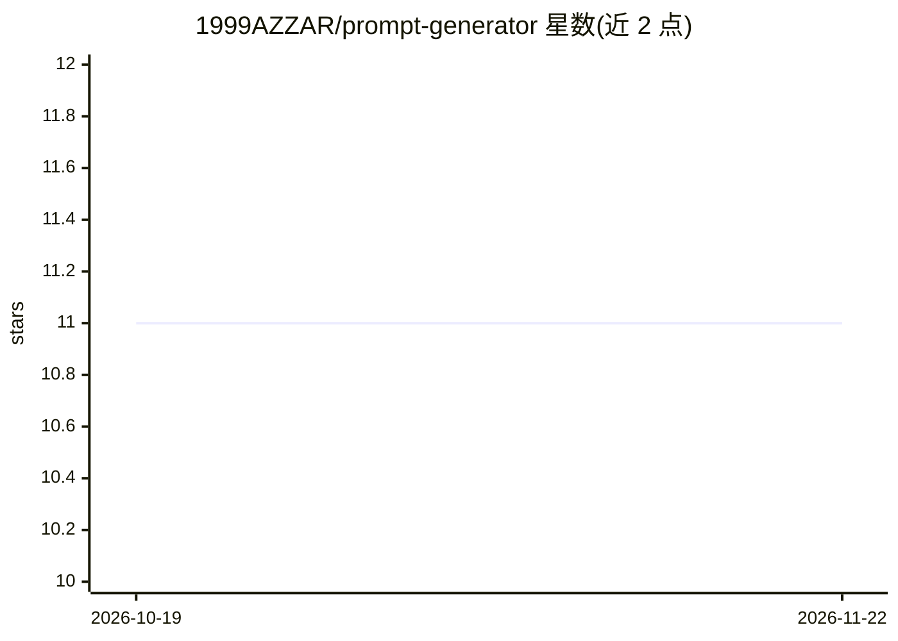

# 1999AZZAR/prompt-generator

⭐ 11 · CSS · 推送 2026-06-07 · [GitHub](https://github.com/1999AZZAR/prompt-generator) · 个人维护

**面向创作者的 Gemini 驱动文本/图像提示词生成 Web 应用**

基于 Flask 和 Google Gemini API 的 Web 应用：用户输入主题后生成结构化的文本与图像提示词，支持上传图片提取提示词，也支持随机生成。生成的提示词可保存到个人库并编辑、复制，数据存于首次运行时自动创建的 SQLite 数据库。界面采用瑞士国际主义排版风格，支持配置多个 API key 以轮询方式调用。安装需克隆仓库、创建虚拟环境并安装依赖后本地运行。

## 筛选速览

| 维度 | 判定 | 备注 |
|---|---|---|
| AI 角色 | `ai-native` | 本体是模型或模型工具 |
| 许可风险 | `none` | — |
| 部署形态 | `library` | 以包/库形式分发 |
| 模型依赖 | — | README 未给出锁定关系 |
| 硬件要求 | — | 无带数字的原话,不猜 |
| 安装摩擦 | `low` | 无编译、无系统依赖或容器化 |
| 成熟度 | — | 结构信号不足 |

## 能力要点

- 从用户输入生成文本与图像两类提示词，支持随机模式
- 上传图片可提取提示词
- 生成的提示词可保存、编辑、复制，存于 SQLite
- 支持多 Gemini API key 逗号分隔轮询使用

## 适用场景

- 为文本到图像工具快速生成结构化提示词
- 把日常灵感主题转成可直接使用的 prompt
- 上传已有图片反推出可复用的提示词并入库管理

## 场景标签

`提示工程` · 领域:Agent 开发

## 证据(README 行号)

> L5: Prompt Sanctuary is a Flask web application powered by the Google Gemini API. It lets users generate structured text
> L64: |Text prompt|Enter a topic → Generate|

## 星数曲线

2026-10-19 11 → 2026-11-22 11（+0）

---
*卡片 v1 · prompt 1.4 · 生成 2026-11-19 · 置信度 high · 依据 README sha `31d7230a3fcd` · [字段定义](../../DATASET.md)*
