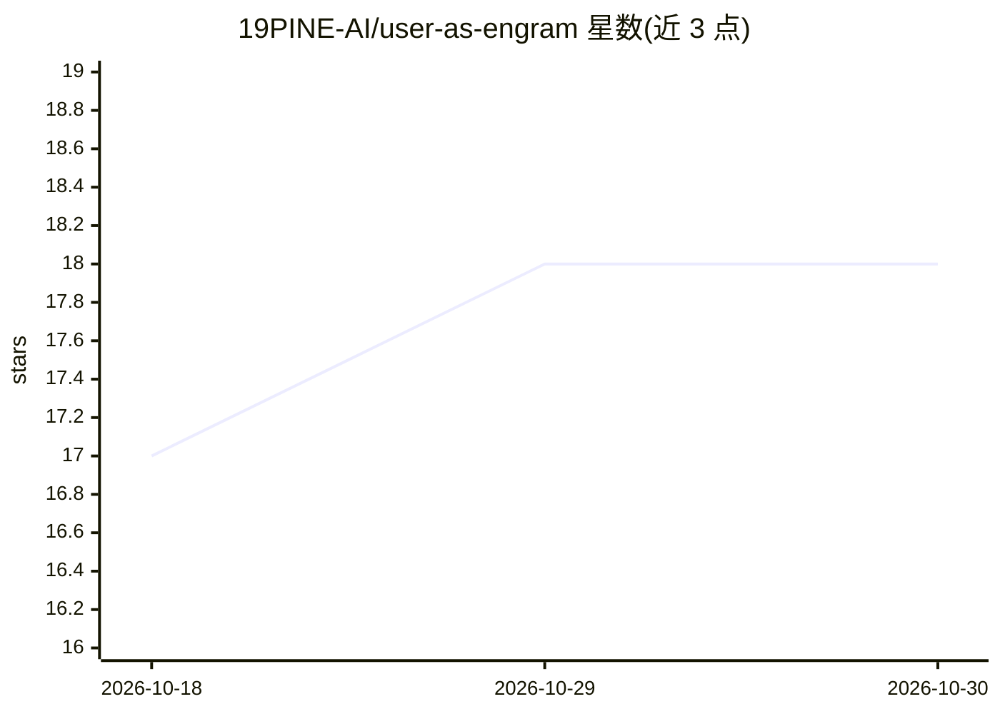

# 19PINE-AI/user-as-engram

⭐ 18 · Python · Apache-2.0 · 推送 2026-07-29 · [GitHub](https://github.com/19PINE-AI/user-as-engram) · [官网](https://01.me/research/user-as-engram/) · 个人维护

**将用户事实写入内容寻址记忆表的单用户记忆方法（论文+代码）**

研究仓库，包含论文、实验代码、合成数据与交互站点。方法将个性化记忆拆为内容与推理技能：用户特定事实以外科手术式编辑写入 Engram 模型的哈希键控记忆表，推理技能存于单一共享 adapter。仓库自包含（基于 vendored 的 nanochat 训练/评测 harness 与 LoRA 基线），已训 checkpoint（178M–1.22B）需自行训练再生。论文数字基于对比 per-user LoRA 的实验报告。复现分四级路径，最快路径仅重建图表、无需 GPU。

## 筛选速览

| 维度 | 判定 | 备注 |
|---|---|---|
| AI 角色 | `ai-native` | 本体是模型或模型工具 |
| 许可风险 | `permissive` | Apache-2.0 |
| 部署形态 | `library` | 以包/库形式分发 |
| 模型依赖 | — | README 未给出锁定关系 |
| 硬件要求 | — | 无带数字的原话,不猜 |
| 安装摩擦 | `low` | 无编译、无系统依赖或容器化 |
| 成熟度 | — | 结构信号不足 |

## 能力要点

- 用户事实编辑写入内容寻址（哈希键控）记忆表，backbone 保持位相同
- 内容/推理技能分离：per-user 内容编辑 + 单一共享 adapter
- 含 vendored nanochat harness、LoRA 基线与全部合成数据，仓库自包含
- REPRODUCE.md 提供从笔记本到完整训练的四级复现路径

## 适用场景

- 复现论文实验与图表（无 GPU 路径）
- 研究 LLM 单用户参数化记忆与知识编辑
- 对比 per-user LoRA 与记忆表编辑的个性化方案

## 场景标签

`科研工具` · 领域:学习与行业

## 证据(README 行号)

> L11: each the right way. Per-user content is written as surgical edits to the
> L32: |`code/`|Everything to run the experiments: the training/eval **harness** (`nanochat_harness/`, vendored, with our 

## 星数曲线

2026-10-18 17 → 2026-10-30 18（+1）

---
*卡片 v1 · prompt 1.4 · 生成 2026-10-29 · 置信度 high · 依据 README sha `b033b5dad00e` · [字段定义](../../DATASET.md)*
