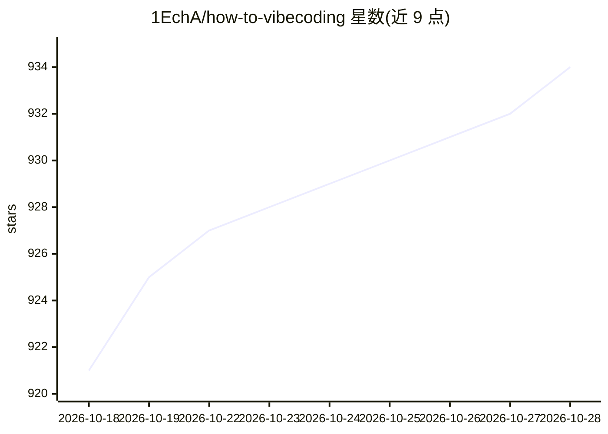

# 1EchA/how-to-vibecoding

⭐ 936 · MIT · 推送 2026-04-27 · [GitHub](https://github.com/1EchA/how-to-vibecoding) · 个人维护 · 中文 README

**Vibecoding 中文系列教程：环境搭建到多智能体协作**

个人维护的 Vibecoding 中文教程合集，以文章目录形式组织，内容涵盖 macOS/Windows 环境搭建、Claude/Gemini/Codex CLI 与 VS Code 配置、MCP 与 Skills 入门、多智能体分工与长任务治理、安全评测与流水线，以及 10 个精选 Skills 推荐。正文托管于 Linux.do 论坛与个人博客，仓库本身作为目录与贡献入口，接受 PR 补充 Skills 配置与报错经验。不提供可安装的软件。

## 筛选速览

| 维度 | 判定 | 备注 |
|---|---|---|
| AI 角色 | `ai-knowledge` | 知识聚合/清单类 |
| 许可风险 | `permissive` | MIT |
| 部署形态 | `None` |  |
| 模型依赖 | — | README 未给出锁定关系 |
| 硬件要求 | — | 无带数字的原话,不猜 |
| 安装摩擦 | `low` | 无编译、无系统依赖或容器化 |
| 成熟度 | — | 结构信号不足 |

## 能力要点

- 覆盖环境搭建、MCP、Skills、多智能体治理的系列文章目录
- 包含 10 个精选 Skills 推荐
- 接受 PR 补充 Skills 配置与报错经验

## 适用场景

- 按目录查找 Vibecoding 环境搭建与工具链配置教程
- 学习 MCP、Skills 与多智能体协作的实战内容
- 分享和补充自己的 Skills 配置经验

## 场景标签

`教程课程` · 领域:学习与行业

## 证据(README 行号)

> L8: > VibeCoding 系列教程：从环境搭建到多智能体协作，覆盖 macOS / Windows 工具链配置、MCP、Skills、Agent 分工治理等核心实战内容。
> L15: ## 📖 文章目录

## 星数曲线

2026-10-18 921 → 2026-10-28 934（+13）

---
*卡片 v1 · prompt 1.4 · 生成 2026-10-21 · 置信度 high · 依据 README sha `86d34ac59408` · [字段定义](../../DATASET.md)*
