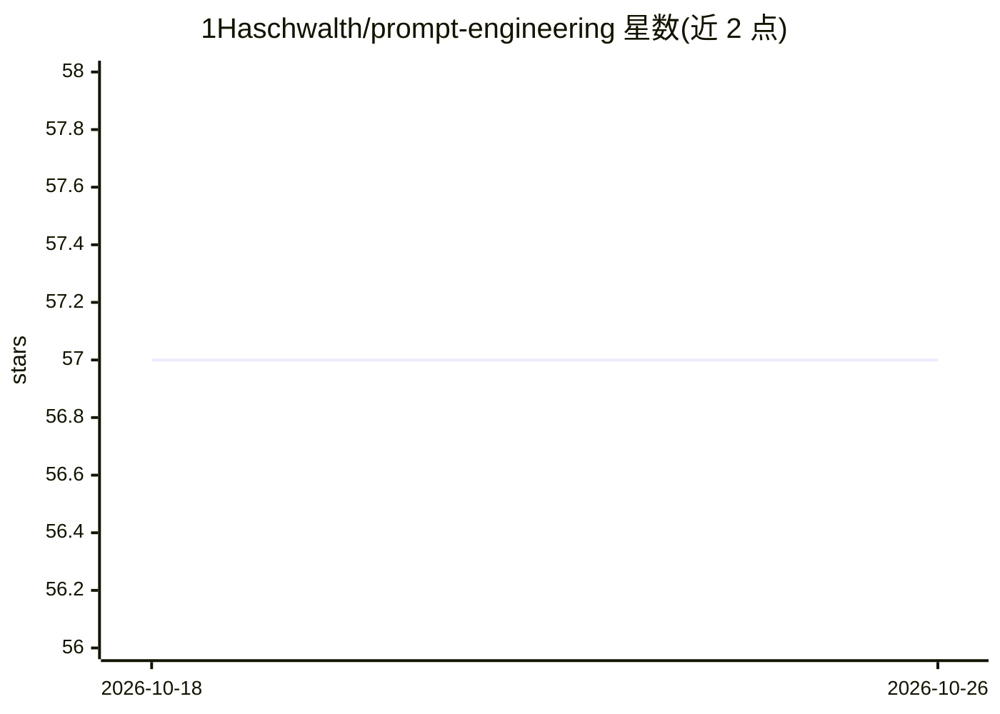

# 1Haschwalth/prompt-engineering

⭐ 57 · Apache-2.0 · 推送 2025-11-09 · [GitHub](https://github.com/1Haschwalth/prompt-engineering) · 个人维护 · 中文 README

**中文 Prompt 工程自学手册：从基础理论到实战与管理**

作者自撰的 Prompt 工程主题电子书《AI精准操作手册：从Prompt工程到认知导航》，以在线阅读形式提供全书内容。全书分 7 篇：理论基础（Prompt 本质与大模型思考机制）、四大核心技法（认知坐标系、推理触发器、输出约束、上下文示例）、动态引导进阶策略、垂直场景模板库与多模型应对策略、团队级 Prompt 版本管理与评估体系、人格工程与未来趋势，另含熵减经济学、神经形态计算等番外篇。面向希望系统学习 Prompt 技巧的个人与团队读者。

## 筛选速览

| 维度 | 判定 | 备注 |
|---|---|---|
| AI 角色 | `ai-knowledge` | 知识聚合/清单类 |
| 许可风险 | `permissive` | Apache-2.0 |
| 部署形态 | `None` |  |
| 模型依赖 | — | README 未给出锁定关系 |
| 硬件要求 | — | 无带数字的原话,不猜 |
| 安装摩擦 | `low` | 无编译、无系统依赖或容器化 |
| 成熟度 | — | 结构信号不足 |

## 能力要点

- 以章节体系覆盖 Prompt 理论、技法、实战与工程化管理
- 提供垂直领域场景化 Prompt 模板库
- 包含 Prompt 版本控制、评估优化与安全风险控制章节

## 适用场景

- 系统自学 Prompt 工程从入门到进阶
- 查找垂直领域的场景化 Prompt 模板
- 为团队建立 Prompt 资产化管理与评估流程

## 场景标签

`提示工程` `教程课程` · 领域:Agent 开发

## 证据(README 行号)

> L1: # AI精准操作手册：从Prompt工程到认知导航 AI Precision Operations Manual: From Prompt Engineering to Cognitive Navigation
> L19:  - 第十章：场景化Prompt库——垂直领域的精准操作模板

## 星数曲线

2026-10-18 57 → 2026-10-26 57（+0）

---
*卡片 v1 · prompt 1.4 · 生成 2026-10-24 · 置信度 high · 依据 README sha `a8c0b4e0fbdc` · [字段定义](../../DATASET.md)*
