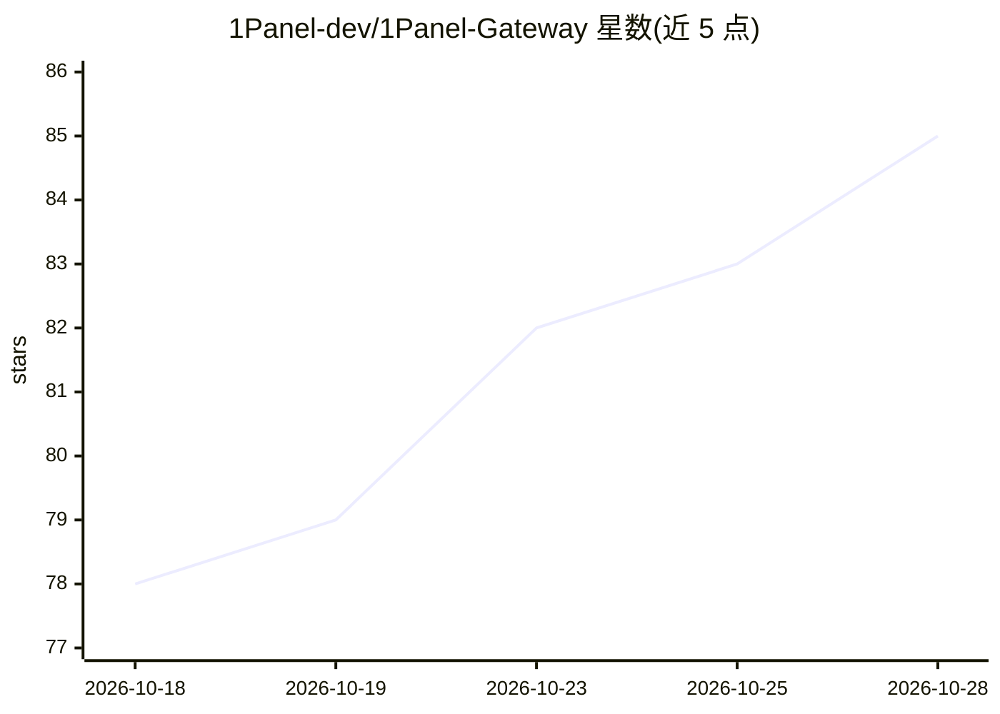

# 1Panel-dev/1Panel-Gateway

⭐ 86 · 推送 2026-10-26 · [GitHub](https://github.com/1Panel-dev/1Panel-Gateway) · [官网](https://1panel.cn/ai-gateway.html) · 组织维护 · 中文 README

**面向企业团队的 AI 统一接入与治理网关平台**

1Panel 团队开发的 AI 网关：AI 应用通过统一 Base URL 与 API Key，经标准接口访问公有云 API、本地 vLLM 集群及其他模型服务。功能包括模型代理与账号池、按用户组/用户/API Key 的席位与权限管理、基于请求内容的智能路由、负载与并发控制、敏感词与语义内容合规审计、用量统计分析。支持 Docker 或 1Panel 应用商店部署，10 人及以下团队免费使用。

## 筛选速览

| 维度 | 判定 | 备注 |
|---|---|---|
| AI 角色 | `ai-ecosystem` | LLM/agent 周边工具 |
| 许可风险 | `none` | — |
| 部署形态 | `self-host` | docker 或自建部署 |
| 模型依赖 | local-ok | 支持本地模型 |
| 硬件要求 | — | 无带数字的原话,不猜 |
| 安装摩擦 | `low` | 无编译、无系统依赖或容器化 |
| 成熟度 | — | 结构信号不足 |

## 能力要点

- 统一接入公有云 API 与本地 vLLM 集群，模型映射与账号池调度
- 席位权限管理：模型权限、并发限制与 Token 配额
- 智能路由按请求内容与规则分发至模型组
- 敏感词、语义审核与调用内容审计

## 适用场景

- 企业统一管理多个模型供应商的接入与 API Key
- 按团队席位控制模型使用权限与 Token 配额
- 对 AI 调用内容做合规审计与用量成本分析

## 场景标签

`模型网关` · 领域:Agent 开发

## 证据(README 行号)

> L10: 1Panel AI 网关是面向企业和团队的 AI 统一接入与治理平台，提供模型代理、智能路由、权限控制、内容合规和用量分析等能力，让 AI 应用更安全、稳定、经济地使用不同模型资源。
> L12: AI 应用只需配置统一的 Base URL 和 API Key，即可通过标准接口访问公有云 API、本地 vLLM 集群及其他模型服务。10 人及以下规模的团队可免费使用完整的 AI 网关治理能力。

## 星数曲线

2026-10-18 78 → 2026-10-28 85（+7）

---
*卡片 v1 · prompt 1.4 · 生成 2026-10-24 · 置信度 high · 依据 README sha `763beded4aaf` · [字段定义](../../DATASET.md)*
