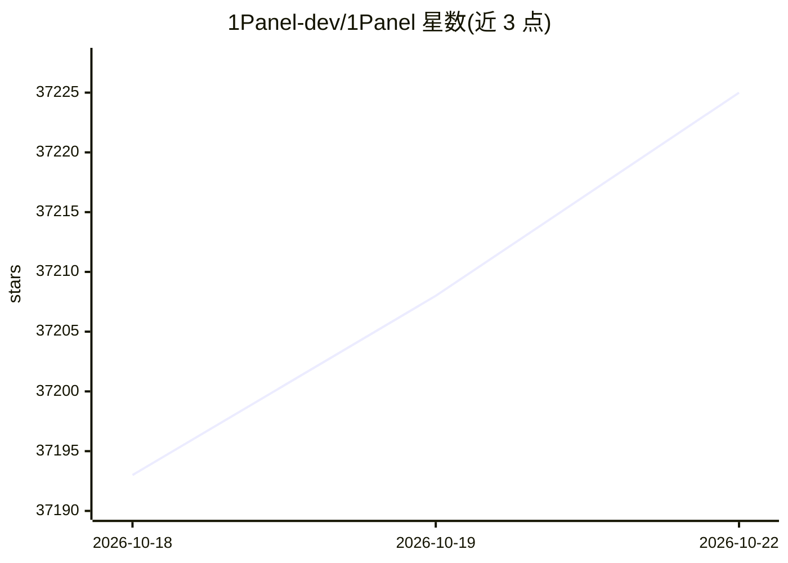

# 1Panel-dev/1Panel

⭐ 37,225 · Go · GPL-3.0 · 推送 2026-10-21 · [GitHub](https://github.com/1Panel-dev/1Panel) · [官网](https://1panel.pro) · 组织维护 · 中文 README

**面向自托管者的 Linux 服务器管理面板与轻量 AI 管理平台**

通过 Web 界面提供 Linux 服务器一站式管理：主机监控、文件/数据库/容器管理、网站一键部署（与 WordPress、Halo 集成）、内置 165+ 开源应用的应用商店一键安装升级、基于容器的部署方式及 WAF 与日志审计等安全功能、一键备份恢复并对接多种云存储。AI 方面提供从裸金属到 agent 的统一管理平台，集成 AI 网关与 Skills Hub，支持集中管理 agent 与模型。通过官方脚本一行命令安装，GPL v3 开源，另有按功能分层收费的 Pro/Ent 版本。

## 筛选速览

| 维度 | 判定 | 备注 |
|---|---|---|
| AI 角色 | `ai-ecosystem` | LLM/agent 周边工具 |
| 许可风险 | `dual` | GPL-3.0 |
| 部署形态 | `None` |  |
| 模型依赖 | — | README 未给出锁定关系 |
| 硬件要求 | — | 无带数字的原话,不猜 |
| 安装摩擦 | `low` | 无编译、无系统依赖或容器化 |
| 成熟度 | — | 结构信号不足 |

## 动量与使用信号

- 维护:`active` — 距上次 push 1.9 天,年发版 30,127 位贡献者
- 涨星:近 1 天 **+10**(自 20261016 起算)
- 安装:github 包 `release-assets` 月下载无数据
- 平台:LINUX / WEB · 协议:—

## 能力要点

- Web 界面管理主机、文件、数据库与容器
- 内置应用商店提供 165+ 应用一键安装与升级
- AI 管理：AI 网关、Skills Hub 与 agent/模型集中管理
- 一键备份恢复并集成多种云存储

## 适用场景

- 自托管场景下用面板管理 Linux 服务器与容器
- 在服务器上快速建站并配置域名与 SSL 证书
- 集中管理服务器上的 AI agent 与模型

## 场景标签

`模型网关` · 领域:Agent 开发

## 证据(README 行号)

> L31: 1Panel is a modern, open-source Linux server management panel and a lightweight AI management platform. Through an 
> L32: - **AI Management**: Offers a unified management platform from bare metal to agents (Metal-to-Agent). It integrates
> L55: bash -c "$(curl -sSL https://resource.1panel.pro/v2/quick_start.sh)"

## 星数曲线

2026-10-18 37,193 → 2026-10-22 37,225（+32）

---
*卡片 v1 · prompt 1.4 · 生成 2026-10-18 · 置信度 high · 依据 README sha `8903b674874b` · [字段定义](../../DATASET.md)*
