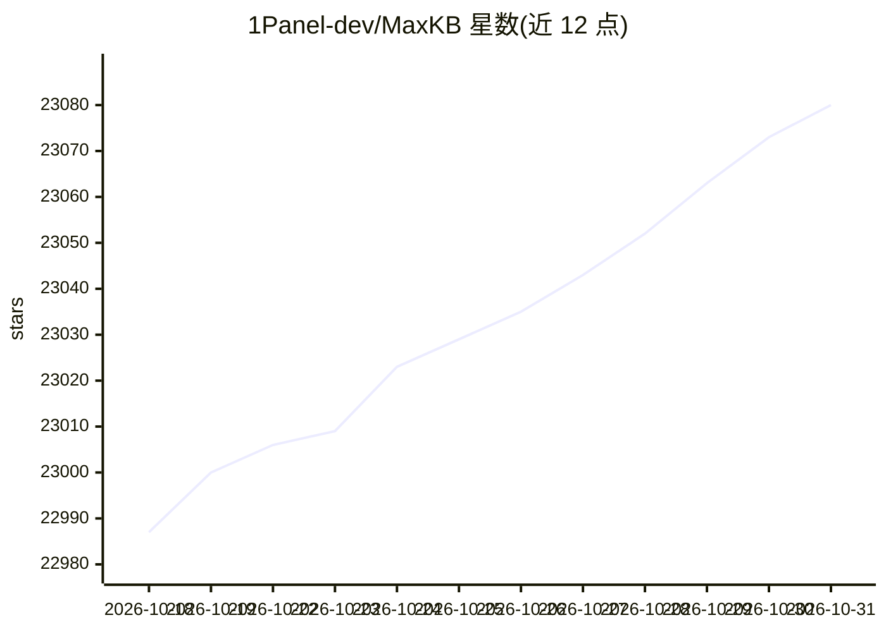

# 1Panel-dev/MaxKB

⭐ 23,080 · Python · GPL-3.0 · 推送 2026-10-30 · [GitHub](https://github.com/1Panel-dev/MaxKB) · [官网](https://maxkb.cn) · 组织维护 · 中文 README

**给企业搭建智能体的开源平台：RAG+工作流+MCP 工具调用**

MaxKB（Max Knowledge Brain）是一个构建企业级智能体的开源平台，集成 RAG 管道（文档上传/在线文档抓取、自动分块、向量化）、工作流引擎、函数库与 MCP 工具调用能力，支持文本/图像/音频/视频多模态输入输出，可零编码接入第三方业务系统。技术栈为 Vue.js + Django + LangChain + PostgreSQL/pgvector，采用 GPL v3 协议，通过 Docker 容器一键启动，适用智能客服、企业内部知识库、学术研究与教育等场景。

## 筛选速览

| 维度 | 判定 | 备注 |
|---|---|---|
| AI 角色 | `ai-native` | 本体是模型或模型工具 |
| 许可风险 | `viral` | GPL-3.0 |
| 部署形态 | `self-host` | docker 或自建部署 |
| 模型依赖 | — | README 未给出锁定关系 |
| 硬件要求 | — | 无带数字的原话,不猜 |
| 安装摩擦 | `low` | 无编译、无系统依赖或容器化 |
| 成熟度 | — | 结构信号不足 |

## 动量与使用信号

- 维护:`active` — 距上次 push 1.8 天,年发版 26,92 位贡献者
- 涨星:近 1 天 **+2**(自 20261016 起算)
- 安装:github 包 `release-assets` 月下载无数据
- 平台:WEB · 协议:MCP

## 能力要点

- RAG 管道：文档上传/自动抓取、自动分块与向量化
- Agentic 工作流引擎、函数库与 MCP 工具调用
- 多模型接入：私有模型与公开模型均支持
- 原生支持文本、图像、音频、视频多模态

## 适用场景

- 搭建企业智能客服系统
- 建设公司内部知识库问答
- 学术研究和教育场景的问答应用
- 为零代码接入现有业务系统添加问答能力

## 场景标签

`RAG` `聊天机器人` `文档问答` `工作流自动化` · 领域:效率与自动化

## 证据(README 行号)

> L14: MaxKB = Max Knowledge Brain, it is an open-source platform for building enterprise-grade agents. MaxKB integrates R
> L19: - **Model-Agnostic**: Supports various large models, including private models (such as DeepSeek, Llama, Qwen, etc.)
> L27: docker run -d --name=maxkb --restart=always -p 8080:8080 -v ~/.maxkb:/opt/maxkb 1panel/maxkb

## 星数曲线

2026-10-18 22,987 → 2026-10-31 23,080（+93）

---
*卡片 v1 · prompt 1.4 · 生成 2026-10-18 · 置信度 high · 依据 README sha `bebb67ed7097` · [字段定义](../../DATASET.md)*
