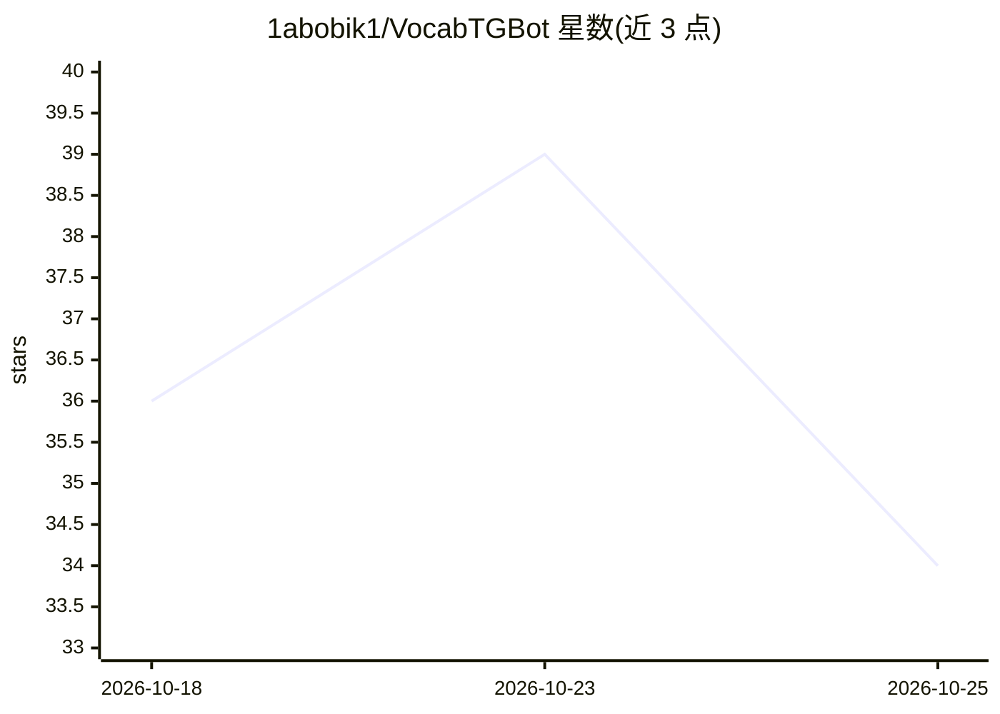

# 1abobik1/VocabTGBot

⭐ 34 · Python · 推送 2026-10-15 · [GitHub](https://github.com/1abobik1/VocabTGBot) · 个人维护

**免费 Telegram 英语背单词机器人，AI 生成例句与语音识别**

面向英语学习者的 Telegram 机器人，完全免费运行于 Cloudflare Workers 免费套餐之上，无需自建服务器或付费 API。功能包括每日 14 个间隔重复卡片（6 个新词）、用户以文字或语音提交自己的造句并由 AI 逐句解析与改写建议、AI 按用户 A1–B2 水平生成三时态例句、10:00 双向默写练习、20:00 语法练习（British Council 67 条规则）与每周进度报告。模型使用 Cloudflare Workers AI 的 Gemma 4 26B 与 Whisper large v3 turbo，数据存于 Cloudflare KV，Python 逻辑同时运行于 Worker（Pyodide）与 GitHub Actions。

## 筛选速览

| 维度 | 判定 | 备注 |
|---|---|---|
| AI 角色 | `ai-native` | 本体是模型或模型工具 |
| 许可风险 | `none` | — |
| 部署形态 | `None` |  |
| 模型依赖 | — | README 未给出锁定关系 |
| 硬件要求 | — | 无带数字的原话,不猜 |
| 安装摩擦 | `low` | 无编译、无系统依赖或容器化 |
| 成熟度 | — | 结构信号不足 |

## 能力要点

- 文字或语音提交造句，AI 逐句解析并给出更自然的表达建议
- AI 按用户水平与语法薄弱点生成三时态例句卡片
- Whisper large v3 turbo 直接解析 Telegram OGG/Opus 语音，无需转码
- 间隔重复：1 天/3 天/30 分钟/2 小时多级调度，练习错误回到起点

## 适用场景

- 利用 Telegram 碎片化背诵英语单词并做间隔重复
- 通过自己造句（可语音）巩固新词并获 AI 反馈
- 按 A1–B2 水平做语法练习与每周进度回顾

## 场景标签

 · 领域:教育/语言学习

## 证据(README 行号)

> L5: __ПОЛНОСТЬЮ БЕСПЛАТНЫЙ__ Telegram-бот для английских слов: без сервера и платных API. Карточки сами приходят в течен
> L28: |ИИ|Cloudflare Workers AI: Gemma 4 26B (тексты), Whisper large v3 turbo (голосовые)|

## 星数曲线

2026-10-18 36 → 2026-10-25 34（-2）

---
*卡片 v1 · prompt 1.4 · 生成 2026-10-25 · 置信度 high · 依据 README sha `3809c4bebaa6` · [字段定义](../../DATASET.md)*
