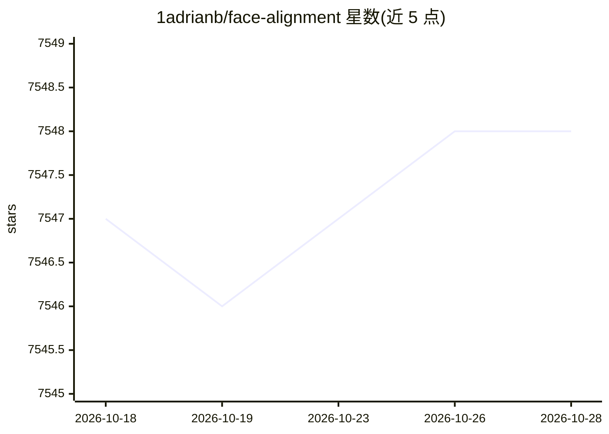

# 1adrianb/face-alignment

⭐ 7,548 · Python · BSD-3-Clause · 推送 2026-04-06 · [GitHub](https://github.com/1adrianb/face-alignment) · [官网](https://www.adrianbulat.com) · 个人维护

**PyTorch 实现的 2D/3D 人脸关键点检测库**

基于 FAN 深度学习方法的人脸对齐 Python 库，检测图片中的 2D 与 3D 人脸关键点，支持整目录批处理。内置多种人脸检测后端（默认 SFD，可选 BlazeFace/YuNet/RetinaFace/SCRFD/dlib），可显式指定 CPU/CUDA/MPS 设备，默认用 torch.compile 加速推理。安装支持 pip、源码编译与 CUDA Docker 镜像；要求 Python 3.9+ 与 PyTorch>=2.0，SCRFD 需可选安装 onnxruntime。附有 ICCV 2017 论文引用。

## 筛选速览

| 维度 | 判定 | 备注 |
|---|---|---|
| AI 角色 | `ai-native` | 本体是模型或模型工具 |
| 许可风险 | `permissive` | BSD-3-Clause |
| 部署形态 | `self-host` | docker 或自建部署 |
| 模型依赖 | — | README 未给出锁定关系 |
| 硬件要求 | — | 无带数字的原话,不猜 |
| 安装摩擦 | `low` | 无编译、无系统依赖或容器化 |
| 成熟度 | — | 结构信号不足 |

## 能力要点

- 检测 2D 与 3D 人脸关键点，支持目录批量处理
- 多种人脸检测后端可切换（SFD/BlazeFace/YuNet/RetinaFace/SCRFD）
- 支持 CPU/CUDA/MPS 设备指定，默认 torch.compile 加速
- 提供 pip、源码与 CUDA Docker 镜像三种安装方式

## 适用场景

- 从图片中提取人脸关键点坐标用于下游任务
- 用预计算边界框跳过检测做评测
- 在不同设备（CPU/GPU/Apple MPS）上运行推理

## 场景标签

`人脸识别` · 领域:感知与多模态

## 证据(README 行号)

> L3: Detect facial landmarks from Python using the world's most accurate face alignment network, capable of detecting poi
> L5: Build using FAN's state-of-the-art deep learning based face alignment method.

## 星数曲线

2026-10-18 7,547 → 2026-10-28 7,548（+1）

---
*卡片 v1 · prompt 1.4 · 生成 2026-10-20 · 置信度 high · 依据 README sha `5dbd6704d2c3` · [字段定义](../../DATASET.md)*
