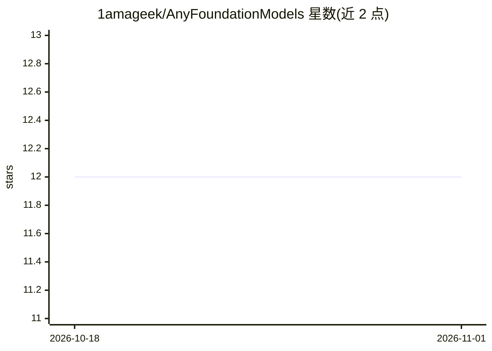

# 1amageek/AnyFoundationModels

⭐ 12 · Swift · 推送 2026-04-28 · [GitHub](https://github.com/1amageek/AnyFoundationModels) · 个人维护

**统一 Swift 接口访问多家语言模型后端的框架**

面向 Swift 开发者的统一 LLM 接入框架：定义 LanguageModel 协议，使 Claude、OpenAI Responses API、Ollama 本地服务、MLX 与 Metal 经 swift-lm 的设备端推理可在同一应用中并用。提供 @Generable 宏的结构化输出（返回类型化 Swift 结构体）、工具自动调用循环、流式响应与 Swift 6 并发支持；通过 trait 门控编译仅构建所需后端以缩减包体积。要求 Swift 6.2+ 与 macOS/iOS/visionOS 26+，以 Swift Package 形式安装。

## 筛选速览

| 维度 | 判定 | 备注 |
|---|---|---|
| AI 角色 | `ai-ecosystem` | LLM/agent 周边工具 |
| 许可风险 | `none` | — |
| 部署形态 | `None` |  |
| 模型依赖 | local-ok | 支持本地模型 |
| 硬件要求 | — | 无带数字的原话,不猜 |
| 安装摩擦 | `low` | 无编译、无系统依赖或容器化 |
| 成熟度 | — | 结构信号不足 |

## 能力要点

- 统一 LanguageModel 协议接入 5 类后端
- @Generable 宏结构化输出返回类型化 Swift 结构体
- 工具调用自动执行循环与流式响应
- trait 门控编译按需构建后端

## 适用场景

- 在 iOS/macOS 应用中接入多家 LLM 供应商
- 本地 MLX/Metal 推理与云端 API 混合使用
- 从 LLM 响应直接获得类型化 Swift 结构体

## 场景标签

`模型网关` · 领域:Agent 开发

## 证据(README 行号)

> L3: A unified Swift framework for interacting with multiple language model providers through a single, protocol-based AP
> L5: Write against the `LanguageModel` protocol and use **Ollama**, **Claude**, **OpenAI Responses API**, **on-device MLX

## 星数曲线

2026-10-18 12 → 2026-11-01 12（+0）

---
*卡片 v1 · prompt 1.4 · 生成 2026-11-01 · 置信度 high · 依据 README sha `365250974f1a` · [字段定义](../../DATASET.md)*
