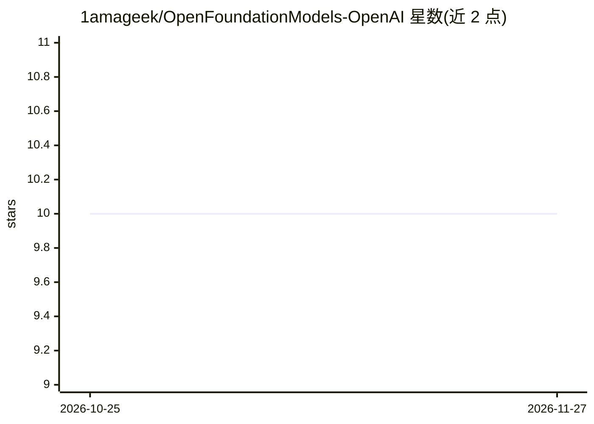

# 1amageek/OpenFoundationModels-OpenAI

⭐ 10 · Swift · 推送 2026-01-28 · [GitHub](https://github.com/1amageek/OpenFoundationModels-OpenAI) · 个人维护

**为 OpenFoundationModels 框架提供 OpenAI 模型接入的 Swift provider**

OpenFoundationModels 框架的 OpenAI provider，让开发者通过 Apple Foundation Models 风格的 API 接口调用 OpenAI 的 GPT 系列与推理系列模型。支持 Transcript 为核心的会话管理、流式响应（SSE）、文本/图像/音频多模态输入（仅 GPT 模型）、工具定义自动提取与转换、结构化生成，并内置按预定义档位（如 Tier 1: 500 RPM/30K TPM）的限速处理。通过 Swift Package Manager 安装，要求 iOS 17+/macOS 14+、Swift 6.1+、Xcode 16+。仓库元数据标注已弃用，建议改用 AnyFoundationModels。

## 筛选速览

| 维度 | 判定 | 备注 |
|---|---|---|
| AI 角色 | `ai-ecosystem` | LLM/agent 周边工具 |
| 许可风险 | `none` | — |
| 部署形态 | `None` |  |
| 模型依赖 | — | README 未给出锁定关系 |
| 硬件要求 | — | 无带数字的原话,不猜 |
| 安装摩擦 | `low` | 无编译、无系统依赖或容器化 |
| 成熟度 | — | 结构信号不足 |

## 能力要点

- 支持 GPT-4o/4o-mini/4-turbo 与 o1/o3/o4-mini 等推理模型的完整列表
- Transcript 为核心的会话架构，无状态模型、全量上下文传递
- 流式响应（SSE）、多模态输入、工具定义自动提取与结构化生成
- 内置限速档位配置与类型安全的参数约束检查

## 适用场景

- 在 Swift/iOS 项目中通过统一接口调用 OpenAI 模型
- 在同一框架下切换 GPT 与推理模型并自动处理参数差异
- 需要流式输出与结构化生成的 Apple 平台应用开发

## 场景标签

 · 领域:LLM 基础设施/模型接入

## 证据(README 行号)

> L3: OpenAI provider for the OpenFoundationModels framework, enabling the use of OpenAI's latest GPT and Reasoning models
> L13: - 🚦 **Self-Contained**: No external dependencies beyond OpenFoundationModels

## 星数曲线

2026-10-25 10 → 2026-11-27 10（+0）

---
*卡片 v1 · prompt 1.4 · 生成 2026-11-20 · 置信度 high · 依据 README sha `927a3b387efb` · [字段定义](../../DATASET.md)*
