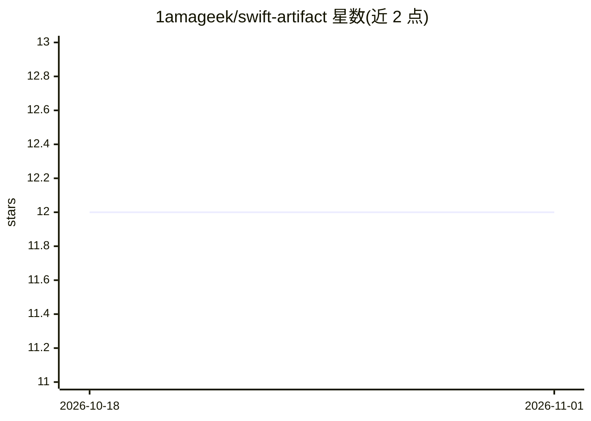

# 1amageek/swift-artifact

⭐ 12 · Swift · MIT · 推送 2026-09-06 · [GitHub](https://github.com/1amageek/swift-artifact) · 个人维护

**SwiftUI 库：在聊天界面渲染 LLM 生成的 artifact 块**

面向 Swift/SwiftUI 开发者的渲染库：解析 Claude 风格的 <artifact> 标签，将其建模为值对象，经可插拔渲染器协议渲染为原生或 WebView 视图，覆盖 Markdown、JSON、CSV、代码、SVG、HTML、React、Mermaid、LaTeX、Vega-Lite、GeoJSON、GLTF、USDZ 及 RDF 系列格式。核心机制是两阶段渲染与流式感知的 refine 步骤，使模型仍在输出时即可绘制部分内容。要求 Swift 6.3+ 与 iOS/macOS/iPadOS/visionOS 26+，通过 Swift Package Manager 安装，提供伞形模块或六个细粒度子库。

## 筛选速览

| 维度 | 判定 | 备注 |
|---|---|---|
| AI 角色 | `ai-ecosystem` | LLM/agent 周边工具 |
| 许可风险 | `permissive` | MIT |
| 部署形态 | `None` |  |
| 模型依赖 | — | README 未给出锁定关系 |
| 硬件要求 | — | 无带数字的原话,不猜 |
| 安装摩擦 | `low` | 无编译、无系统依赖或容器化 |
| 成熟度 | — | 结构信号不足 |

## 能力要点

- 解析 Claude 风格 artifact 标签并按 MIME 类型路由到注册渲染器
- 流式部分渲染：JSON/SVG/Mermaid/RDF 等格式边生成边绘制
- 本地与 HTTPS 文件入口 ArtifactCanvas，含 MIME 检测与大小限制（远程 128 MiB/文本 8 MiB）
- 伞形模块或六个细粒度库按需引入（如仅 Markdown 客户端可不带 WebKit）

## 适用场景

- 在 iOS/macOS 聊天应用中展示 LLM 生成的 artifact 内容
- 流式输出期间实时渲染部分完成的 JSON、SVG、Mermaid 等结构
- 以同一渲染注册表展示本地或 HTTPS 文件（Markdown、代码、PDF、3D 模型等）

## 场景标签

 · 领域:LLM 应用界面组件

## 证据(README 行号)

> L3: A Swift/SwiftUI library for displaying LLM-generated `<artifact>` blocks inside chat
> L5: one through a pluggable renderer protocol — with first-class support for **partial

## 星数曲线

2026-10-18 12 → 2026-11-01 12（+0）

---
*卡片 v1 · prompt 1.4 · 生成 2026-11-01 · 置信度 high · 依据 README sha `996d35c2f7e4` · [字段定义](../../DATASET.md)*
