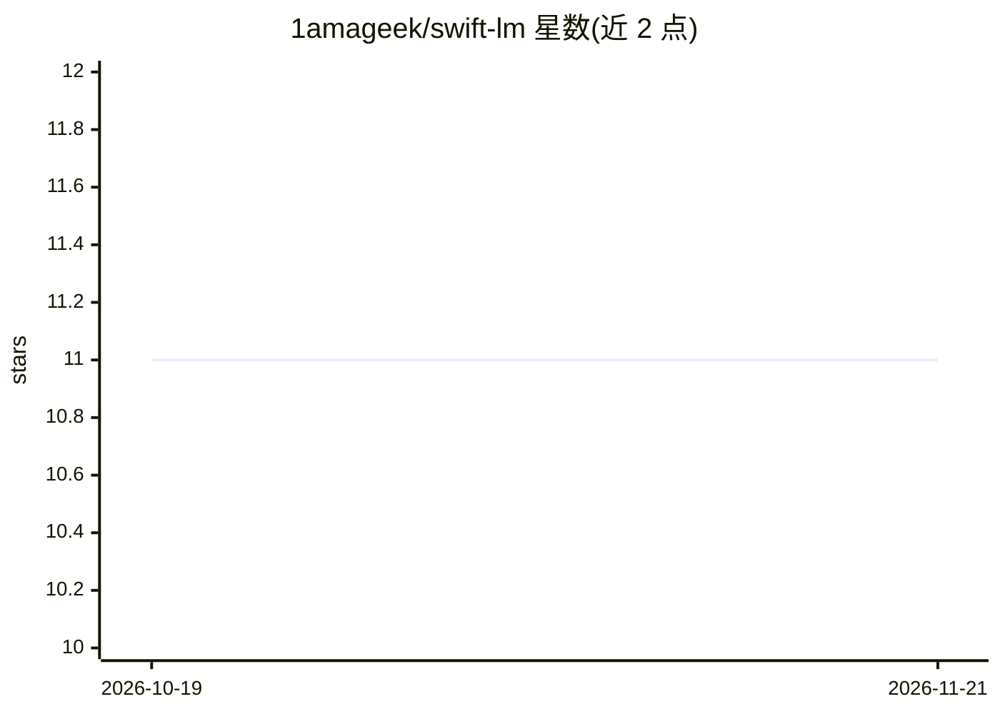

# 1amageek/swift-lm

⭐ 11 · Swift · 推送 2026-07-18 · [GitHub](https://github.com/1amageek/swift-lm) · 个人维护

**Swift 库：在 Apple 平台加载并运行 Hugging Face LLM**

面向 Apple 平台的 Swift 包：从 Hugging Face 模型的 config.json 构建后端无关的声明式模型图（LMIR），校验后导出给 Apple Core AI 工具链执行；0.10 的直连 Metal 运行时作为兼容路径保留，提供文本生成、文本嵌入与多模态（图像/视频）API。要求 Xcode 27 beta、Swift 6.4+、macOS/iOS 27+ 与 Apple Silicon。以模型族表声明支持的架构，不支持的族在加载阶段显式失败而不回退。

## 筛选速览

| 维度 | 判定 | 备注 |
|---|---|---|
| AI 角色 | `ai-ecosystem` | LLM/agent 周边工具 |
| 许可风险 | `none` | — |
| 部署形态 | `library` | 以包/库形式分发 |
| 模型依赖 | — | README 未给出锁定关系 |
| 硬件要求 | — | 无带数字的原话,不猜 |
| 安装摩擦 | `medium` | 含编译或系统依赖之一 |
| 成熟度 | — | 结构信号不足 |

## 能力要点

- 读取 Hugging Face config.json 生成 Core AI 导出文档，Python 端经 coreai-torch 校验与 lowers
- 支持文本生成、文本嵌入（如 EmbeddingGemma）与图像/视频多模态输入
- 声明式 LMIR 模型图跨后端共享，safetensors 为规范权重来源
- 支持 Llama、Qwen、Gemma、Mistral、DeepSeek、ChatGLM 等 20+ model_type 族

## 适用场景

- 在 iPhone/Mac 应用中本地加载 Hugging Face 模型做对话生成
- 为 Apple 设备上的应用生成文本嵌入向量
- 将本地 HF 模型转换为 Apple Core AI 可执行包

## 场景标签

`多模态` `推理引擎` · 领域:感知与多模态

## 证据(README 行号)

> L5: `swift-lm` loads Hugging Face model metadata, builds a backend-independent graph from a declarative Swift model defi
> L14: - Python tooling that validates and lowers Swift LMIR through `coreai-torch`.
> L23: - Apple Silicon for local Core AI execution

## 星数曲线

2026-10-19 11 → 2026-11-21 11（+0）

---
*卡片 v1 · prompt 1.4 · 生成 2026-11-19 · 置信度 low · 依据 README sha `6435719eaffd` · [字段定义](../../DATASET.md)*
