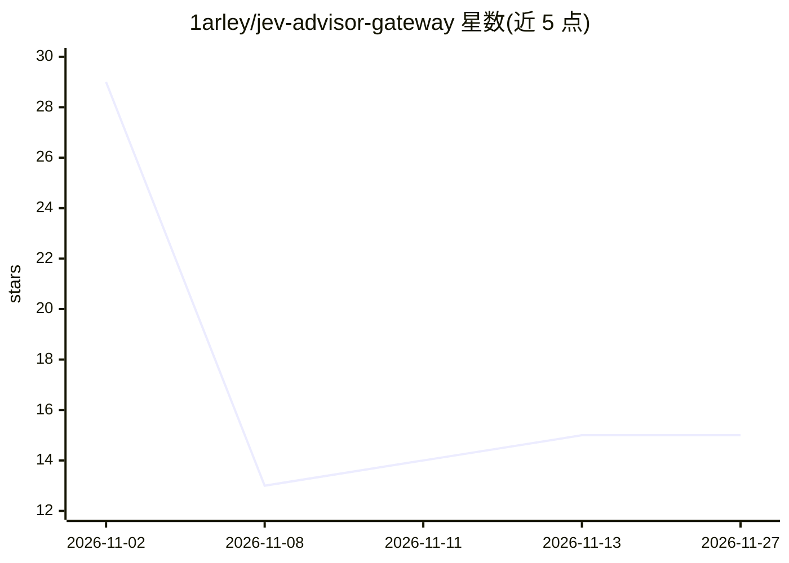

# 1arley/jev-advisor-gateway

⭐ 15 · TypeScript · MIT · 推送 2026-11-09 · [GitHub](https://github.com/1arley/jev-advisor-gateway) · 个人维护

**本地网关：让 Jev 决定编码 agent 的工具调用，可附加只读 advisor**

运行于编码 agent 与 LLM 上游之间的回环网关：对含工具的请求，由 Jev 选择一个工具并填充枚举/布尔等闭集参数，开放性参数与最终回答仍由会话模型负责；Jev 不确定、超时或解析失败时原样放行（fail-open）。可选只读 advisor 在选定轮次接收最多 6 条近期纯文本消息并附加受限备注，不能调用工具或修改响应链。支持 Codex、Claude Code、OpenCode、Kilo、Gemini CLI、Antigravity CLI、Devin 七种客户端，决策后端可选 TypeSafe、OpenRouter、Vercel、OpenCode Zen 及本地 OpenJev/Laya/Jiwo/Kev。提供启动器、仪表盘与 OpenAI/Anthropic/Gemini 兼容服务端模式。

## 筛选速览

| 维度 | 判定 | 备注 |
|---|---|---|
| AI 角色 | `ai-ecosystem` | LLM/agent 周边工具 |
| 许可风险 | `permissive` | MIT |
| 部署形态 | `library` | 以包/库形式分发 |
| 模型依赖 | locked-api |  |
| 硬件要求 | — | 无带数字的原话,不猜 |
| 安装摩擦 | `low` | 无编译、无系统依赖或容器化 |
| 成熟度 | — | 结构信号不足 |

## 能力要点

- Jev 选取工具并填充闭集参数，开放参数与最终回答由会话模型保留
- 不确定/超时/解析失败一律原样转发，不依赖决策服务即可成功
- 只读 advisor 仅接收有限纯文本消息、不能调用工具或更改响应
- 支持 7 种编码 agent 客户端与托管/本地共 8 种 Jev 决策后端

## 适用场景

- 在 Codex/Claude Code 等编码 agent 中引入外部工具选择决策
- 为编码会话附加只读 GPT/Claude 顾问备注
- 通过仪表盘查看路由决策、延迟与成本等元数据

## 场景标签

`模型网关` · 领域:Agent 开发

## 证据(README 行号)

> L7: A local gateway that lets Jev choose a coding agent's next tool. The session model keeps control of
> L66: coding agent -> loopback gateway -> Jev selects a tool or passes

## 星数曲线

2026-11-02 29 → 2026-11-27 15（-14）

---
*卡片 v1 · prompt 1.4 · 生成 2026-11-18 · 置信度 high · 依据 README sha `f102361f60cc` · [字段定义](../../DATASET.md)*
