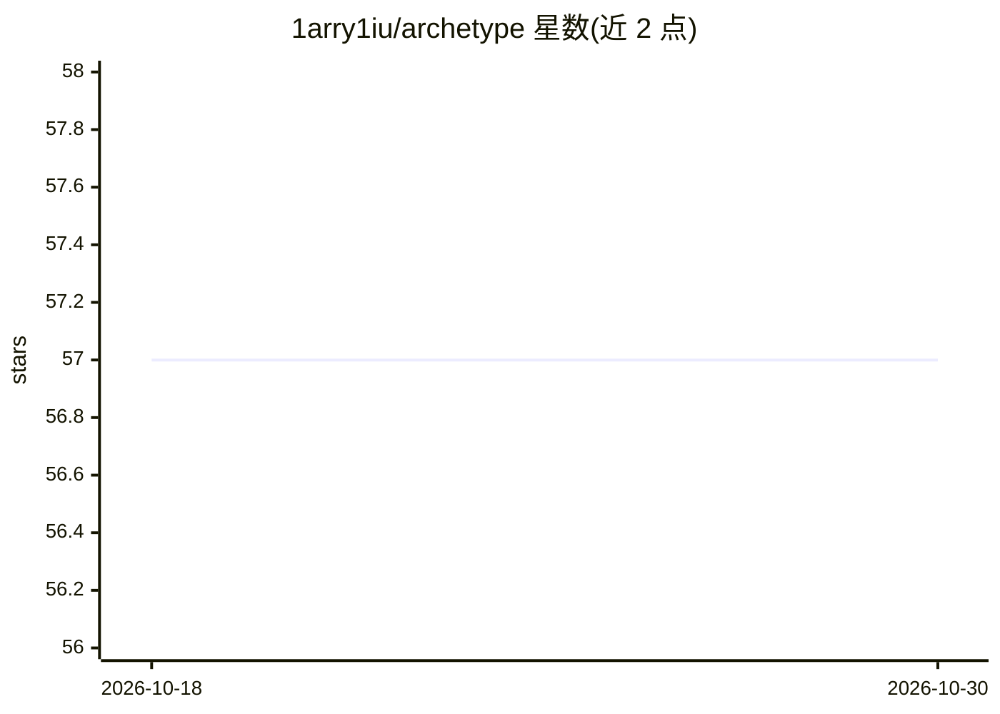

# 1arry1iu/archetype

⭐ 57 · Python · Apache-2.0 · 推送 2026-10-27 · [GitHub](https://github.com/1arry1iu/archetype) · 个人维护 · 中文 README

**面向领域专家与创作的可复用 LLM 提示词规范库**

以 Markdown 规格形式组织的 LLM 提示词与知识架构库：包含 21 个 Construct 可复用推理模块（原型、评价、格式、工作流等）与 21 个独立领域专家规范（分析心理学、人类学、法学、研究方法、前后端开发、中/泰语言学等），另有 35 个 ZIP 打包快照（26 个主题包、8 个 GPT 包、1 个 Grok 包）。供使用者自行抽取并适配到目标模型、工具与任务。README 明确说明：ZIP 为手工快照，不含自动重建、完整性校验与平台导入测试。

## 筛选速览

| 维度 | 判定 | 备注 |
|---|---|---|
| AI 角色 | `ai-knowledge` | 知识聚合/清单类 |
| 许可风险 | `permissive` | Apache-2.0 |
| 部署形态 | `None` |  |
| 模型依赖 | — | README 未给出锁定关系 |
| 硬件要求 | — | 无带数字的原话,不猜 |
| 安装摩擦 | `low` | 无编译、无系统依赖或容器化 |
| 成熟度 | — | 结构信号不足 |

## 能力要点

- 42 个 Markdown 规格：21 个 Construct 模块 + 21 个独立专家规范
- 35 个签入 ZIP 快照（GPT/Grok/主题分发）
- 模块可独立使用或组合使用
- 提供 `python -m zipfile -t` 做基础 ZIP 完整性检查

## 适用场景

- 为 LLM 抽取领域知识与推理协议以适配目标任务
- 组合 Construct 模块构建跨领域提示词架构
- 导入 GPT/Grok 平台的打包技能快照

## 场景标签

`提示工程` · 领域:Agent 开发

## 证据(README 行号)

> L3: **Archetype** is an evolving library of LLM prompt architectures, reusable reasoning modules, specialist knowledge s
> L39: |Reusable foundations|`blocks/Construct/`|21 Markdown modules|Archetypes, knowledge, judgment, modeling, validation

## 星数曲线

2026-10-18 57 → 2026-10-30 57（+0）

---
*卡片 v1 · prompt 1.4 · 生成 2026-10-24 · 置信度 high · 依据 README sha `cf4eb7e3f22a` · [字段定义](../../DATASET.md)*
