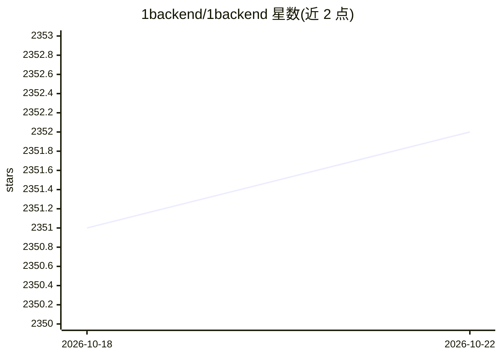

# 1backend/1backend

⭐ 2,352 · Go · AGPL-3.0 · 推送 2026-05-27 · [GitHub](https://github.com/1backend/1backend) · [官网](https://1backend.com) · 组织维护

**AI 时代的全栈微服务/微前端自托管平台**

面向 AI 时代的全栈应用平台：作为框架、代理与运行时，处理认证、用户账户、微服务与微前端路由、邮件等基础能力；可在容器内运行和编排 LLM，自带 ORM，无数据库也能开发。支持多租户、自动 SSL、边缘代理模式，单机安装可托管多个应用或站点。提供 Go/JS SDK 与 oo CLI（需 Go 安装），桌面版发行已暂时停止。

## 筛选速览

| 维度 | 判定 | 备注 |
|---|---|---|
| AI 角色 | `ai-ecosystem` | LLM/agent 周边工具 |
| 许可风险 | `viral` | AGPL-3.0 |
| 部署形态 | `self-host` | docker 或自建部署 |
| 模型依赖 | — | README 未给出锁定关系 |
| 硬件要求 | — | 无带数字的原话,不猜 |
| 安装摩擦 | `low` | 无编译、无系统依赖或容器化 |
| 成熟度 | — | 结构信号不足 |

## 能力要点

- 框架+代理+运行时一体，处理认证/路由/邮件等基础设施
- 可在容器内运行和编程 LLM（零信任、零配置）
- 同时管理微服务与微前端（React/Vue/Angular 等）并自动 SSL
- 多租户：一次安装可托管多个应用或站点

## 适用场景

- 快速搭建分布式 AI 应用而无需前期基础设施投入
- 在自有服务器上自托管多个应用或站点
- 将微服务与微前端统一注册、路由和代理

## 场景标签

`推理引擎` · 领域:训练与推理

## 证据(README 行号)

> L18: 1Backend is a full-stack platform for the AI era. It lets you build distributed applications fast, without early in
> L20: It can run and program LLMs inside containers. Zero-trust, zero-config, with its own ORM for development even witho

## 星数曲线

2026-10-18 2,351 → 2026-10-22 2,352（+1）

---
*卡片 v1 · prompt 1.4 · 生成 2026-10-21 · 置信度 high · 依据 README sha `a46cff3d267f` · [字段定义](../../DATASET.md)*
