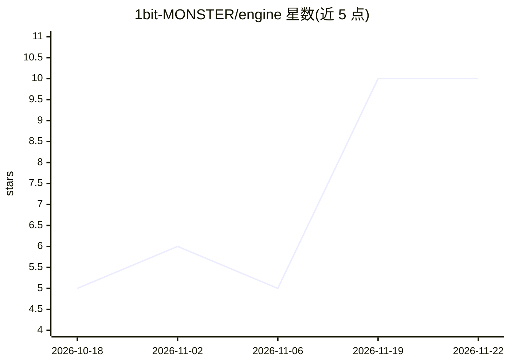

# 1bit-MONSTER/engine

⭐ 10 · C++ · Apache-2.0 · 推送 2026-11-21 · [GitHub](https://github.com/1bit-MONSTER/engine) · [官网](https://1bit.gg/) · 个人维护

**AMD Strix Halo 上的本地 LLM 推理引擎：单二进制跑 GPU 与 NPU**

面向 AMD Ryzen AI MAX+ 395（Strix Halo）的 Linux 本地 LLM 推理引擎。通过 HRX 与自研 HIP kernel 在 Radeon 8060S iGPU（gfx1151）上服务任意 GGUF 模型，通过自研 NPU runtime 在 XDNA 2 NPU 上运行模型，作为 AMD Lemonade Server 的后端对外提供 OpenAI 兼容 API。随 1bit OS（Puppy Linux 定制镜像）发布，支持 USB 启动或写入磁盘安装；也以 lemonade-onebit 包形式供已装 Lemonade 的用户添加后端。Apache-2.0 许可。

## 筛选速览

| 维度 | 判定 | 备注 |
|---|---|---|
| AI 角色 | `ai-ecosystem` | LLM/agent 周边工具 |
| 许可风险 | `permissive` | Apache-2.0 |
| 部署形态 | `desktop` | 安装包/桌面程序 |
| 模型依赖 | local-ok | 支持本地模型 |
| 硬件要求 | — | 无带数字的原话,不猜 |
| 安装摩擦 | `medium` | 含编译或系统依赖之一 |
| 成熟度 | — | 结构信号不足 |

## 能力要点

- 单二进制模型无关推理：支持任意 GGUF 量化、ONNX 图与 NPU 模型包
- HRX + 自研 HIP kernel 驱动 Radeon 8060S iGPU，自研 runtime 驱动 XDNA 2 NPU
- 作为 Lemonade Server 后端提供 OpenAI 兼容 API
- 1bit OS 定制镜像 USB 启动即用，支持 Secure Boot

## 适用场景

- 在 Strix Halo 机器上本地运行 GGUF 大模型
- 通过 OpenAI 兼容 API 接入本地推理服务
- 给已有 Lemonade 部署的 Ubuntu 系统添加 GPU/NPU 推理后端

## 场景标签

`推理引擎` · 领域:训练与推理

## 证据(README 行号)

> L9: One binary to rule them all: the 1bit engine is a model-agnostic local LLM inference engine for the
> L12: backend of AMD's Lemonade Server and its OpenAI-compatible API.
> L54: One binary to rule them all. The 1bit engine is model agnostic: any Hugging Face architecture, any GGUF quantizatio

## 星数曲线

2026-10-18 5 → 2026-11-22 10（+5）

---
*卡片 v1 · prompt 1.4 · 生成 2026-11-20 · 置信度 high · 依据 README sha `afe2b11e676e` · [字段定义](../../DATASET.md)*
