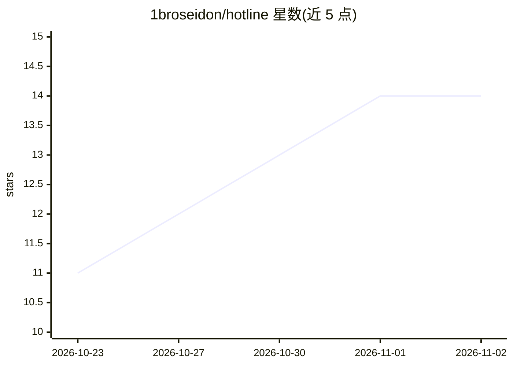

# 1broseidon/hotline

⭐ 14 · Rust · Apache-2.0 · 推送 2026-10-31 · [GitHub](https://github.com/1broseidon/hotline) · [官网](https://hotline.dev) · 个人维护

**自托管的多 AI agent 协作房间，桌面端+手机端**

基于 Rust 与 Tauri 构建的开源自托管应用：在用户本机提供一个由多个命名 agent 队友组成的"房间"，每个队友有自己的项目目录和持续会话，可互相发消息、协作与交接任务。内置 agent 支持 Anthropic/OpenAI/Google/OpenRouter/Ollama 等模型，Claude Code、Codex 等 ACP agent 可作为队友接入；可为队友分配运行于 Docker/Podman/Apple container 的独立 Linux 容器桌面。数据留在本地磁盘，提供 macOS/Windows/Linux 桌面端、无头服务器模式与配对的手机应用（beta）。

## 筛选速览

| 维度 | 判定 | 备注 |
|---|---|---|
| AI 角色 | `ai-ecosystem` | LLM/agent 周边工具 |
| 许可风险 | `permissive` | Apache-2.0 |
| 部署形态 | `None` |  |
| 模型依赖 | local-ok | 支持本地模型 |
| 硬件要求 | — | 无带数字的原话,不猜 |
| 安装摩擦 | `low` | 无编译、无系统依赖或容器化 |
| 成熟度 | — | 结构信号不足 |

## 能力要点

- 多个 agent 队友同室协作，会话独立持续运行
- 支持 Anthropic/OpenAI/Google/OpenRouter/Ollama 混用，可接入 Claude Code、Codex 等 ACP agent
- 队友可拥有独立 Linux 容器桌面（Docker/Podman/Apple container）
- 本地自托管，transcripts 与文件留在本机磁盘

## 适用场景

- 让多个 AI 编码 agent 在同一项目中分工协作并互相评审
- 从桌面或手机随时查看和介入 agent 队友的工作
- 为 agent 提供隔离的容器化 Linux 环境执行任务

## 场景标签

`多智能体` `编码 Agent` · 领域:Agent 开发

## 证据(README 行号)

> L28: - **Any model, mixed in one room.** Anthropic, OpenAI, Google, OpenRouter or
> L30: - **Bring your own harness.** Claude Code, Codex, opencode or any ACP agent runs
> L32: - **A computer of its own.** One switch gives a teammate a whole Linux desktop in

## 星数曲线

2026-10-23 11 → 2026-11-02 14（+3）

---
*卡片 v1 · prompt 1.4 · 生成 2026-10-31 · 置信度 high · 依据 README sha `15276edb5874` · [字段定义](../../DATASET.md)*
