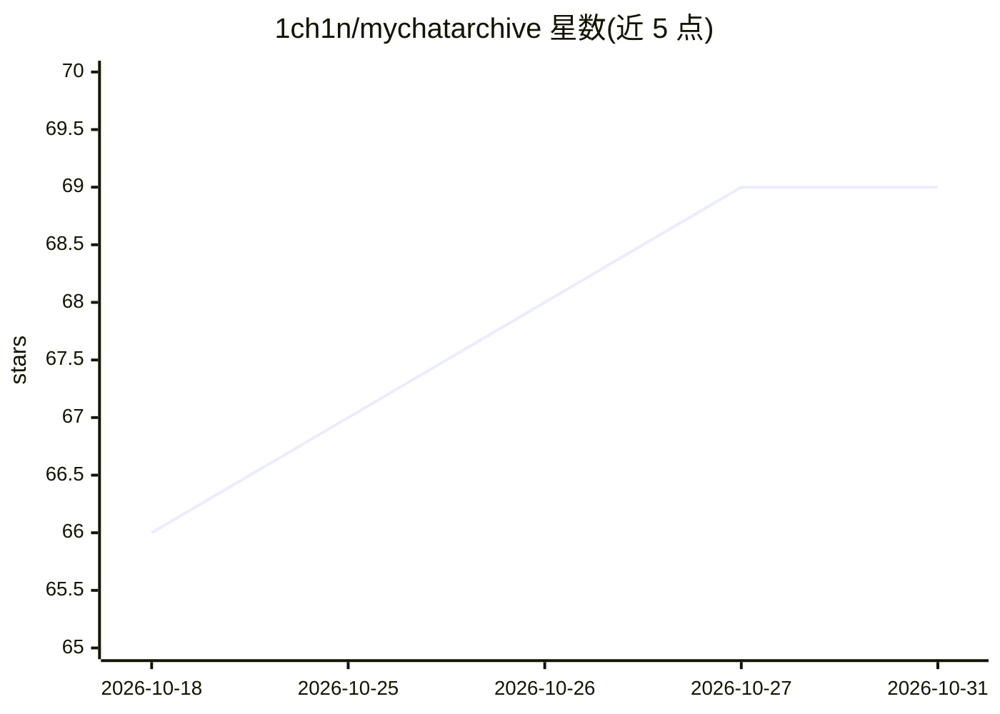

# 1ch1n/mychatarchive

⭐ 69 · Python · NOASSERTION · 推送 2026-08-05 · [GitHub](https://github.com/1ch1n/mychatarchive) · [官网](https://mychatarchive.com) · 个人维护

**本地优先的 AI 对话存档库：导入导出记录并经 MCP 供 AI 工具检索**

将 ChatGPT、Claude、Grok 导出文件及 Claude Code、Cursor 本机会话汇聚到单一 SQLite 归档，用 sentence-transformers 在本地生成向量嵌入，通过 MCP 服务器向 Claude Desktop、Cursor 等 AI 客户端提供语义搜索、上下文包、想法捕获等 6 个工具。同步、嵌入、搜索、服务均无需 API key；仅可选的 summarize 步骤调用 OpenRouter/Anthropic API。支持线程分组与 public/private/sealed 三级敏感度管控，sealed 内容不会经 MCP 返回。核心流程 AGPL 开源，云端同步在路线图中。

## 筛选速览

| 维度 | 判定 | 备注 |
|---|---|---|
| AI 角色 | `ai-ecosystem` | LLM/agent 周边工具 |
| 许可风险 | `dual` | NOASSERTION |
| 部署形态 | `library` | 以包/库形式分发 |
| 模型依赖 | — | README 未给出锁定关系 |
| 硬件要求 | — | 无带数字的原话,不猜 |
| 安装摩擦 | `low` | 无编译、无系统依赖或容器化 |
| 成熟度 | — | 结构信号不足 |

## 能力要点

- 三层导入（自动发现/投放文件夹/命名源）经 SHA1 去重入单一 SQLite
- 本地 sentence-transformers 嵌入，核心功能无需 API key
- MCP 服务器提供 search_brain 等 6 个工具，支持 stdio 与 SSE 传输
- public/private/sealed 三级敏感度在数据访问层强制执行

## 适用场景

- 让 Claude Desktop 或 Cursor 语义搜索我的历史对话
- 把散落各平台的 AI 对话集中归档并本地全文/向量检索
- 对含敏感内容的线程做分级，控制 agent 可访问范围

## 场景标签

`语义搜索` `Agent 记忆` · 领域:Agent 开发

## 证据(README 行号)

> L39: Import your chat exports from ChatGPT, Claude, Grok, Claude Code, and Cursor. Generate vector embeddings locally wi
> L52: |**MCP server**|Claude Desktop, Cursor, Claude Code, and any MCP client can search your archive.|

## 星数曲线

2026-10-18 66 → 2026-10-31 69（+3）

---
*卡片 v1 · prompt 1.4 · 生成 2026-10-24 · 置信度 mid · 依据 README sha `d22cd54d08c6` · [字段定义](../../DATASET.md)*
