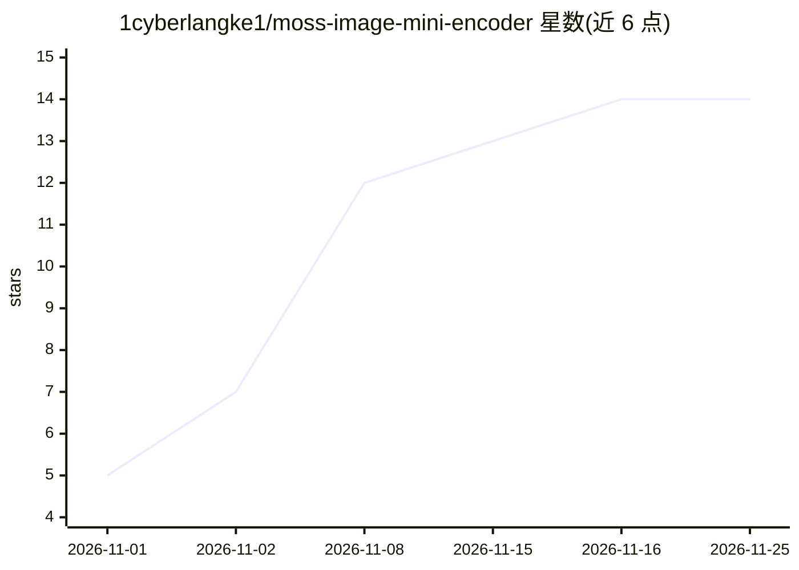

# 1cyberlangke1/moss-image-mini-encoder

⭐ 14 · Python · Apache-2.0 · 推送 2026-11-03 · [GitHub](https://github.com/1cyberlangke1/moss-image-mini-encoder) · 个人维护 · 中文 README

**用小型 Qwen3.5 替换 MOSS-Image 9B 文本编码器的投影方案**

为 MOSS-Image 文生图模型提供轻量化文本编码器替代方案：用 0.8B/2B/4B 的 Qwen3.5 学生模型加一层逐 token 线性投影适配器，将隐藏状态映射到 4096 维输入 DiT；语言模型推理时冻结仅作特征提取。提供 bf16/int8/w4a8 三种量化的多档规格、Ridge 闭式解训练流程、Hugging Face 权重发布，以及 ComfyUI 自定义节点（MossCLIPLoader）。仅适用于 MOSS-Image 的 4096 维条件输入，跨尺寸混用会报维度错误。

## 筛选速览

| 维度 | 判定 | 备注 |
|---|---|---|
| AI 角色 | `ai-native` | 本体是模型或模型工具 |
| 许可风险 | `permissive` | Apache-2.0 |
| 部署形态 | `None` |  |
| 模型依赖 | — | README 未给出锁定关系 |
| 硬件要求 | — | 无带数字的原话,不猜 |
| 安装摩擦 | `low` | 无编译、无系统依赖或容器化 |
| 成熟度 | — | 结构信号不足 |

## 能力要点

- 0.8B/2B/4B 三档学生模型与 bf16/int8/w4a8 量化规格，最小档显存约 1.02 GB
- 逐 token 线性投影适配器（Ridge 闭式解），语言模型推理时全程冻结
- 提供 ComfyUI 自定义节点 MossCLIPLoader，CLIP 输出接口与官方标准兼容
- 附 10 条提示词 × 8 档的出图效果、余弦对齐与耗时评测数据

## 适用场景

- 在消费级显卡上降低 MOSS-Image 文本编码器的显存开销
- 在 ComfyUI 工作流中按显存预算选择不同量化档位出图
- 基于相同词表的 Qwen3.5 系列做特征对齐实验

## 场景标签

`图像生成` `模型量化` · 领域:内容生成

## 证据(README 行号)

> L5: MOSS-Image 官方默认的 9B 文本编码器体积较大，在消费级显卡上运行时显存压力明显。本项目使用较小尺寸的 **Qwen3.5 (0.8B / 2B / 4B)** 替换原生 9B 文本编码器，通过一层轻量的逐 token 
> L67: ## 在 ComfyUI 中使用

## 星数曲线

2026-11-01 5 → 2026-11-25 14（+9）

---
*卡片 v1 · prompt 1.4 · 生成 2026-11-18 · 置信度 high · 依据 README sha `8c36c2fb2f67` · [字段定义](../../DATASET.md)*
