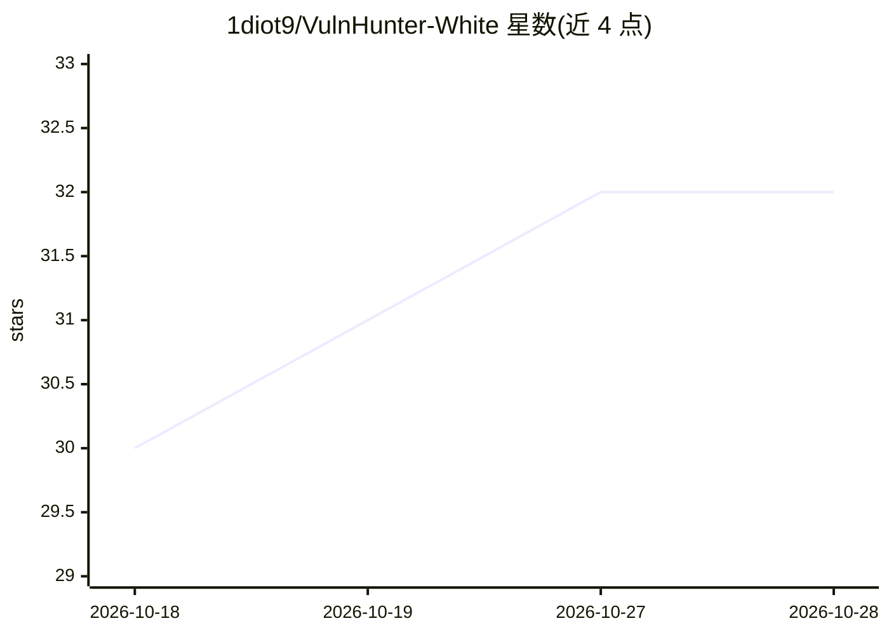

# 1diot9/VulnHunter-White

⭐ 32 · Python · Apache-2.0 · 推送 2026-10-11 · [GitHub](https://github.com/1diot9/VulnHunter-White) · 个人维护 · 中文 README

**面向安全研究者的 LLM 白盒漏洞挖掘 Agent**

导入 GitHub 仓库或源码 zip 后，经多角色流水线（Recon→四条挖掘路径→Reviewer→可选 Verifier）完成漏洞挖掘与审核：支持启发式、快速扫描 Sink 回溯、历史漏洞绕过、无约束四种挖掘路径，靶场动态/局部 harness/纯静态三种验证方式，可选 FOFA 互联网复现与攻击链串联；产出中文报告、Advisory 与 CVE JSON。兼容 OpenAI Chat Completions/Responses、Anthropic Messages 协议接入模型商池（测试过 GLM、DeepSeek、百炼）。需 Python 3.11+、Node 20、Git，另提供 Docker 一键启动；模型需自行在设置页配置 API 才能运行。

## 筛选速览

| 维度 | 判定 | 备注 |
|---|---|---|
| AI 角色 | `ai-native` | 本体是模型或模型工具 |
| 许可风险 | `permissive` | Apache-2.0 |
| 部署形态 | `desktop` | 安装包/桌面程序 |
| 模型依赖 | — | README 未给出锁定关系 |
| 硬件要求 | — | 无带数字的原话,不猜 |
| 安装摩擦 | `low` | 无编译、无系统依赖或容器化 |
| 成熟度 | — | 结构信号不足 |

## 能力要点

- 四条挖掘路径：启发式/快速扫描 Sink 回溯/历史漏洞绕过/无约束
- 三种验证方式：Docker 靶场动态、局部 harness（L1/L2/L3）、纯静态
- 可选 FOFA 互联网复现与攻击链串联，Human-in-the-loop 确认
- 产出中文报告、Advisory、CVE JSON 与产出日历

## 适用场景

- 对开源仓库做白盒漏洞挖掘并生成报告/Advisory
- 按历史漏洞绕过思路复检已修复代码
- 通过靶场动态或局部 harness 验证漏洞可利用性
- 串联多个漏洞形成攻击链并做互联网复现确认

## 场景标签

`网络安全` · 领域:学习与行业

## 证据(README 行号)

> L9: 基于 LLM 的白盒漏洞挖掘 Agent。四条挖掘路径（启发式、快速扫描 Sink 回溯、历史漏洞绕过、无约束）+ Docker 靶场 / 局部 harness / 静态验证，支持互联网复现与攻击链串联。
> L13: **流水线概要**：Recon（代码地图、鉴权、历史漏洞、文件定权）完成后开始挖掘；创建时可勾选代码库（CodeGraph 源码图 + 可选 Jar Analyzer 业务 jar 图，默认关），开启后与 Recon 并列、地图 

## 星数曲线

2026-10-18 30 → 2026-10-28 32（+2）

---
*卡片 v1 · prompt 1.4 · 生成 2026-10-26 · 置信度 mid · 依据 README sha `766b6a0e3e2b` · [字段定义](../../DATASET.md)*
