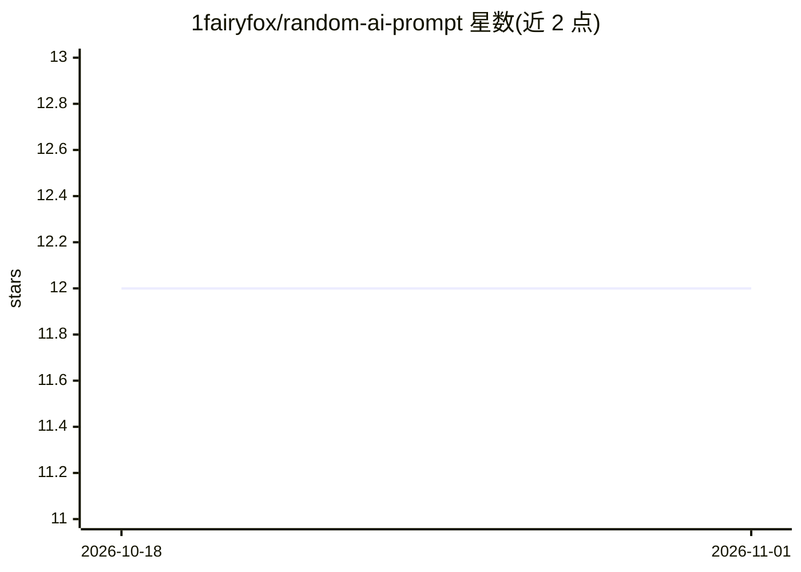

# 1fairyfox/random-ai-prompt

⭐ 12 · JavaScript · Apache-2.0 · 推送 2026-10-14 · [GitHub](https://github.com/1fairyfox/random-ai-prompt) · [官网](https://prompt.fairyfox.io) · 个人维护

**AI 图像/文本提示词生成器：积木式组合扩展成完整提示词**

开源的 AI 提示词生成工具：用户从场景、主体、风格的内置库中组合模块，通过自带的组合语言 DPL（token 可嵌套、可加强度与聚焦百分比）将一句话想法展开为详细且每次不同的提示词，引擎确定性且可设种子复现。生成结果可通过约 40 个图像/文本后端（OpenAI、Anthropic、Gemini、Midjourney、FLUX、Stability 等）用自带 API key 直接在浏览器/桌面端调用，也可只生成提示词文本（无需 key）。以浏览器版与桌面版（Windows/macOS/Linux 预构建包）两种形态发布，数据仅存本地，桌面版额外含画廊、内容管理器与本地 Stable Diffusion 提供方。

## 筛选速览

| 维度 | 判定 | 备注 |
|---|---|---|
| AI 角色 | `ai-native` | 本体是模型或模型工具 |
| 许可风险 | `permissive` | Apache-2.0 |
| 部署形态 | `desktop` | 安装包/桌面程序 |
| 模型依赖 | locked-api |  |
| 硬件要求 | — | 无带数字的原话,不猜 |
| 安装摩擦 | `low` | 无编译、无系统依赖或容器化 |
| 成熟度 | — | 结构信号不足 |

## 能力要点

- DPL 组合语言：token 嵌套、组合、重展开，支持强度/聚焦百分比调节
- 约 40 个图像与文本后端，自带 key、请求直达提供方、不经服务器
- 引擎确定性与可设种子，同种子复现同提示词
- 双形态发布：免安装在线版（可自托管静态包）与预构建桌面版（含画廊、本地 SD 提供方、18+ 模式）

## 适用场景

- 不想手写长提示词时，用积木块快速生成详细 AI 绘图/文本提示词
- 把生成的提示词直接送到 Midjourney、DALL·E 等模型出图
- 离线/本地生成提示词文本供其他工具复用
- 自托管在线版或本地桌面版，保证 API key 与数据不离开设备

## 场景标签

`提示工程` · 领域:Agent 开发

## 证据(README 行号)

> L27: Random AI Prompt is an open-source generator for AI image and text prompts. Instead of making
> L74: - **Provider-agnostic, bring-your-own-key.** Around 40 image and text backends behind one interface,

## 星数曲线

2026-10-18 12 → 2026-11-01 12（+0）

---
*卡片 v1 · prompt 1.4 · 生成 2026-11-01 · 置信度 high · 依据 README sha `4029fbad1473` · [字段定义](../../DATASET.md)*
