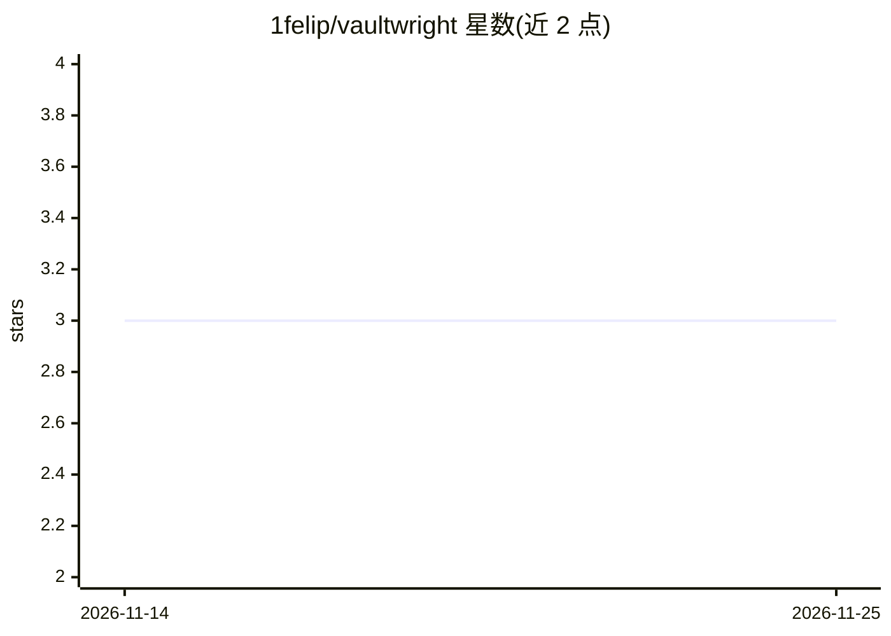

# 1felip/vaultwright

⭐ 3 · PowerShell · MIT · 推送 2026-11-13 · [GitHub](https://github.com/1felip/vaultwright) · 个人维护

**在 Obsidian 中分阶段生成项目规划文档的 AI 规划 agent**

以 Claude Code 插件形式运行的规划 agent：读取用户的想法文件，在 Obsidian vault 中创建规划仓库，通过十个阶段（愿景到指标）的定制表单向用户提问，将回答综合为阶段计划、主计划与决策记录（ADR 风格）。支持推断预填、按需建议、缺口与矛盾校验，可将计划通过 CLAUDE.md/AGENTS.md 段落与代码仓库关联。输出为纯 Markdown，无数据库依赖。需要 Claude Code 或其他编码 agent 与 Obsidian vault。

## 筛选速览

| 维度 | 判定 | 备注 |
|---|---|---|
| AI 角色 | `ai-native` | 本体是模型或模型工具 |
| 许可风险 | `permissive` | MIT |
| 部署形态 | `None` |  |
| 模型依赖 | — | README 未给出锁定关系 |
| 硬件要求 | — | 无带数字的原话,不猜 |
| 安装摩擦 | `low` | 无编译、无系统依赖或容器化 |
| 成熟度 | — | 结构信号不足 |

## 能力要点

- 十个规划阶段的表单驱动流程（Vision→Metrics）
- 从想法推断的答案预填并标记，不覆盖用户回答
- /vw-save 校验缺口与矛盾并生成阶段计划与决策记录
- 方法为纯 Markdown，可由 Codex CLI、Cursor、Copilot 等 agent 运行

## 适用场景

- 把粗略想法逐阶段打磨成带决策记录的主计划
- 让编码 agent 在开发前读取 vault 中的主计划
- 用多语言表单规划软件、活动、研究、书籍等非代码项目

## 场景标签

`AI 写作` · 领域:内容生成

## 证据(README 行号)

> L7: **An AI planning agent for Claude Code and any coding agent.** Vaultwright reads your idea, builds a planning reposi
> L22: - 🧭 **Staged.** Ten stages, from Vision to Metrics. Each one is planned only when the previous one is solid.
> L210: Vaultwright is a **Claude Code plugin** made of:

## 星数曲线

2026-11-14 3 → 2026-11-25 3（+0）

---
*卡片 v1 · prompt 1.4 · 生成 2026-11-22 · 置信度 high · 依据 README sha `dbf99f6f9c90` · [字段定义](../../DATASET.md)*
