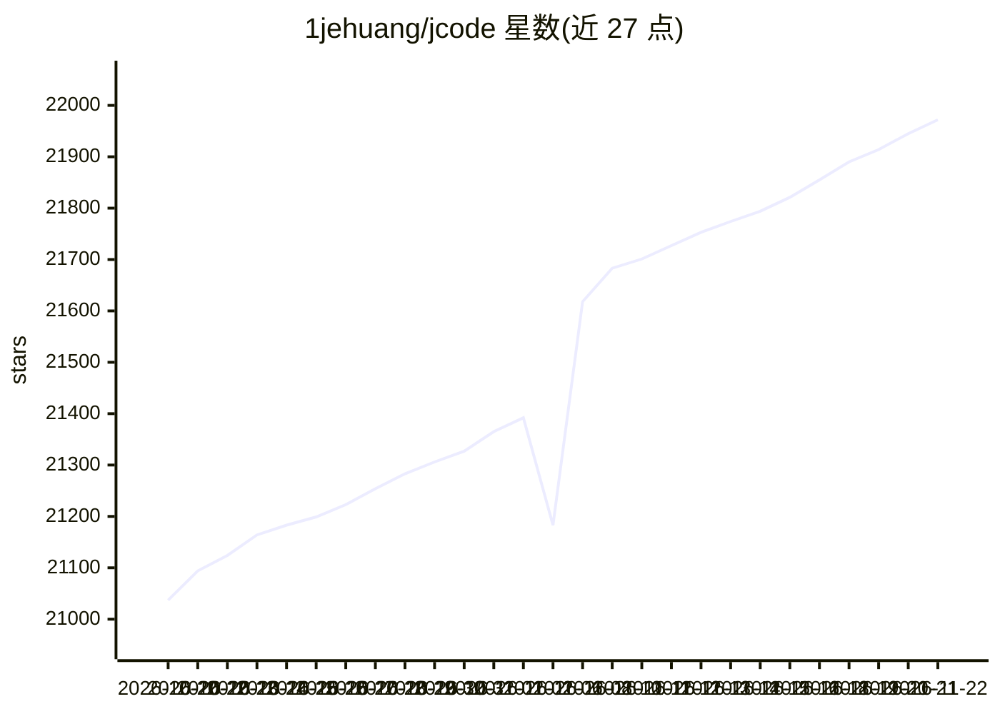

# 1jehuang/jcode

⭐ 21,972 · Rust · MIT · 推送 2026-11-21 · [GitHub](https://github.com/1jehuang/jcode) · [官网](https://jcode.sh) · 个人维护

**为重度多 agent 开发工作流设计的 Rust 编码 agent 运行壳**

用 Rust 编写的编码 agent 工具（TUI/CLI），主打在单机上并行运行数十个 agent 会话，官方基准数据列出各会话的内存占用与首输入延迟。核心机制：由服务端管理同一仓库内的多 agent 协作，包括文件变更通知、agent 间私信与广播消息、冲突协调；agent 可通过 swarm 工具自主生成子 agent 形成协调者-工作者结构。支持 Claude OAuth 与 OpenAI Codex OAuth 等多种 provider，提供 self-dev 模式让 agent 修改自身源码并重建重载。macOS/Linux 通过脚本安装。

## 筛选速览

| 维度 | 判定 | 备注 |
|---|---|---|
| AI 角色 | `ai-ecosystem` | LLM/agent 周边工具 |
| 许可风险 | `permissive` | MIT |
| 部署形态 | `None` |  |
| 模型依赖 | — | README 未给出锁定关系 |
| 硬件要求 | — | 无带数字的原话,不猜 |
| 安装摩擦 | `low` | 无编译、无系统依赖或容器化 |
| 成熟度 | — | 结构信号不足 |

## 动量与使用信号

- 维护:`active` — 距上次 push 0.9 天,年发版 100,44 位贡献者
- 涨星:近 1 天 **+62**(自 20261016 起算)
- 下载:GitHub Release 附件 累计 531,938(100 个 release)
- 平台:WINDOWS / MACOS / LINUX · 协议:—

## 能力要点

- 服务端管理的多 agent 协作：文件冲突通知、DM 与广播消息
- agent 可自主 spawn swarm 子 agent，支持 headless/headed
- 支持 Claude OAuth 与 OpenAI Codex OAuth
- self-dev 模式：agent 编辑、构建、测试并重载自身二进制

## 适用场景

- 在同一仓库并行跑多个编码 agent 会话
- 让多 agent 团队自动协调处理代码变更冲突
- 低内存环境下批量运行无头 agent

## 场景标签

`编码 Agent` `多智能体` `工作流自动化` · 领域:Agent 开发

## 证据(README 行号)

> L7:  High-performance coding agents.
> L79: Spawn two or more agents in the same repo, and they will automatically be managed by the server to allow native col
> L85: Supports a wide range of providers, including Claude OAuth and OpenAI Codex OAuth.

## 星数曲线

2026-10-20 21,037 → 2026-11-22 21,972（+935）

---
*卡片 v1 · prompt 1.4 · 生成 2026-11-22 · 置信度 high · 依据 README sha `e3d5c1ba889c` · [字段定义](../../DATASET.md)*
