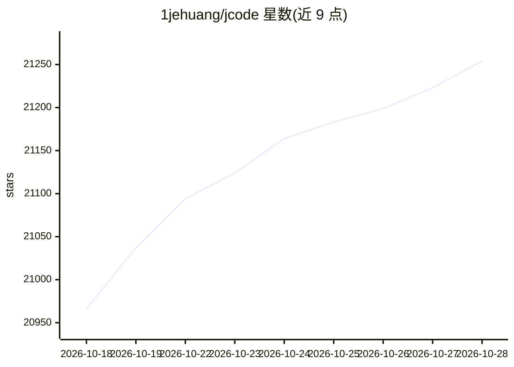

# 1jehuang/jcode

⭐ 21,254 · Rust · MIT · 推送 2026-10-27 · [GitHub](https://github.com/1jehuang/jcode) · [官网](https://jcode.sh) · 个人维护

**Rust 编写的终端编码 Agent，支持数十个 Agent 并行协作**

面向重度多 Agent 开发工作流的终端编码 Agent（TUI）：以低内存占用支持并行运行大量 Agent 会话，渲染内联图片与 LaTeX。核心机制包括 Swarm——同一仓库内多个 Agent 由服务端托管，文件被他人编辑时自动通知、冲突自动协调，Agent 可自主派生子团队并由主 Agent 担任协调者；agentgrep 工具附带文件结构信息并按已见内容裁剪以节省上下文；支持 Claude OAuth 与 OpenAI Codex OAuth 等多种接入方式；self dev 模式下 Agent 可修改、构建并重载自身源码。macOS/Linux 通过 curl 脚本安装，Windows 另有说明。

## 筛选速览

| 维度 | 判定 | 备注 |
|---|---|---|
| AI 角色 | `ai-native` | 本体是模型或模型工具 |
| 许可风险 | `permissive` | MIT |
| 部署形态 | `None` |  |
| 模型依赖 | locked-api |  |
| 硬件要求 | — | 无带数字的原话,不猜 |
| 安装摩擦 | `low` | 无编译、无系统依赖或容器化 |
| 成熟度 | — | 结构信号不足 |

## 动量与使用信号

- 维护:`active` — 距上次 push 0.9 天,年发版 100,44 位贡献者
- 涨星:近 1 天 **+62**(自 20261016 起算)
- 下载:GitHub Release 附件 累计 531,938(100 个 release)
- 平台:WINDOWS / MACOS / LINUX · 协议:—

## 能力要点

- Swarm 多 Agent 托管：文件变更通知与冲突自动协调
- Agent 可自主派生子团队并行执行任务
- agentgrep 附带文件结构并按已见内容自适应裁剪以节省上下文
- 支持 Claude OAuth 与 OpenAI Codex OAuth 等多种 Provider 接入

## 适用场景

- 在终端并行运行多个编码 Agent 处理同一仓库的任务
- 让多个 Agent 协作并自动解决文件编辑冲突
- 以低内存占用运行大量并发 Agent 会话

## 场景标签

`编码 Agent` `多智能体` · 领域:Agent 开发

## 证据(README 行号)

> L7:  High-performance coding agents.
> L8:  Run dozens of agents in parallel without melting your machine. More agents, less RAM, no lag.
> L78: Spawn two or more agents in the same repo, and they will automatically be managed by the server to allow native col

## 星数曲线

2026-10-18 20,966 → 2026-10-28 21,254（+288）

---
*卡片 v1 · prompt 1.4 · 生成 2026-10-20 · 置信度 high · 依据 README sha `9c5cb17c28da` · [字段定义](../../DATASET.md)*
