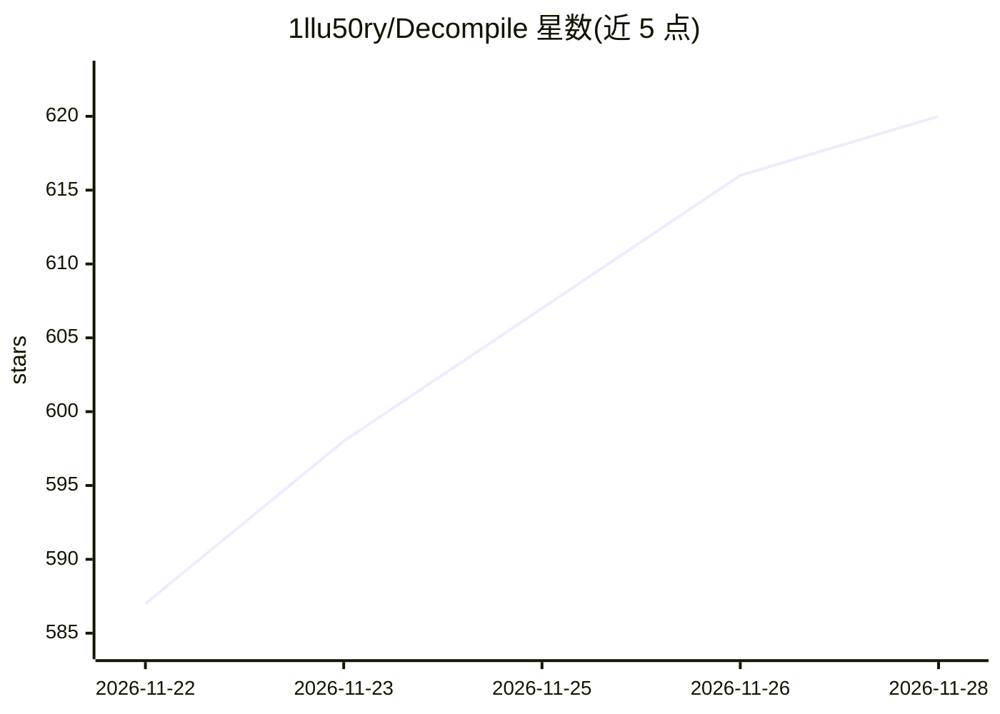

# 1llu50ry/Decompile

⭐ 620 · TypeScript · MIT · 推送 2026-11-23 · [GitHub](https://github.com/1llu50ry/Decompile) · [官网](https://github.com/1llu50ry/Decompile) · 个人维护 · 中文 README

**面向游戏逆向/安全研究的 MCP 服务器，聚合反编译工具与技能库**

一个 MCP 服务器，为逆向工程工作流提供统一接入层：将 60+ 个 RE/调试后端（Ghidra、IDA、Binary Ninja、radare2、x64dbg 等）聚合在一个连接之后，内置 230+ 原生工具（PE/ELF/Mach-O/DEX/WASM 等格式解析、熵分析、签名扫描），并提供 6,000+ 技能、170+ agent、多 agent mesh 协作与 CLI（setup/analyze/doctor）。通过 install.sh/PowerShell/npx 安装，需 Node.js 24+；商业工具（IDA 等）仅在已安装时挂接插件。

## 筛选速览

| 维度 | 判定 | 备注 |
|---|---|---|
| AI 角色 | `ai-ecosystem` | LLM/agent 周边工具 |
| 许可风险 | `permissive` | MIT |
| 部署形态 | `desktop` | 安装包/桌面程序 |
| 模型依赖 | locked-api |  |
| 硬件要求 | — | 无带数字的原话,不猜 |
| 安装摩擦 | `high` | 编译与系统依赖俱全 |
| 成熟度 | — | 结构信号不足 |

## 能力要点

- 一条连接聚合 60+ RE/调试 MCP 后端，smart_decompile 按可用性自动挑选
- 230+ 原生工具覆盖 PE/ELF/Mach-O/DEX/WASM/Minidump 等格式解析与熵分析
- 6,000+ 技能、170+ agent、190+ 插件的全文可检索知识库（BM25）
- 多 agent mesh：DM、频道、任务交接、对抗投票、共享 KV 知识库

## 适用场景

- 把 Ghidra/IDA/radare2 等逆向工具统一接入 Claude Code/Cursor 等 MCP 客户端
- 对自有或授权分析的二进制做加壳识别、反编译与结构恢复
- 反外挂工程师研究绕过手法并加固检测
- 恶意样本分析中做脱壳、IOC 提取与技术分类

## 场景标签

`多智能体` `网络安全` · 领域:Agent 开发

## 证据(README 行号)

> L3: ### One MCP for reverse engineering across binaries, applications, and runtime behavior.
> L25: 5. **Ships a one-shot CLI** (`decompile setup`, `decompile analyze <path>`, `decompile capabilities`, `decompile do
> L106: Point your MCP client at it, then ask any of:

## 星数曲线

2026-11-22 587 → 2026-11-28 620（+33）

---
*卡片 v1 · prompt 1.4 · 生成 2026-11-25 · 置信度 mid · 依据 README sha `aa8d8dfa9286` · [字段定义](../../DATASET.md)*
