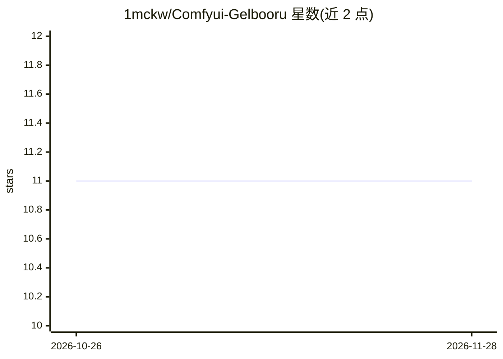

# 1mckw/Comfyui-Gelbooru

⭐ 11 · Python · 推送 2026-06-28 · [GitHub](https://github.com/1mckw/Comfyui-Gelbooru) · 个人维护

**ComfyUI 自定义节点：从 Gelbooru/Rule34 按标签抓取随机图片**

为 ComfyUI 提供一组自定义节点，通过 Gelbooru 与 Rule34 的 API 按标签过滤（OR/AND/排除标签）、帖子 ID 或直接 URL 抓取随机图片帖子，输出标签串、图片 URL、尺寸、来源等字段，并可下载图片输出为 IMAGE 张量。提供标签处理管线（去坏标签、加质量标签、背景/颜色标签调整等），配置通过 good_tags.txt 与 bad_tags.txt 自定义。安装需克隆到 ComfyUI 的 custom_nodes 目录并 pip 安装依赖；Gelbooru 抓取需用户自备 API key 与 user ID。

## 筛选速览

| 维度 | 判定 | 备注 |
|---|---|---|
| AI 角色 | `ai-enhanced` | 去掉 AI 部分产品仍成立 |
| 许可风险 | `none` | — |
| 部署形态 | `desktop` | 安装包/桌面程序 |
| 模型依赖 | — | README 未给出锁定关系 |
| 硬件要求 | — | 无带数字的原话,不猜 |
| 安装摩擦 | `low` | 无编译、无系统依赖或容器化 |
| 成熟度 | — | 结构信号不足 |

## 能力要点

- 按 AND/OR/排除标签、评分阈值与分级开关过滤图片帖子
- 标签处理管线：去坏标签、加质量标签、背景与颜色标签调整
- 可下载图片并输出为 IMAGE 张量，支持确定性随机种子
- 支持 base64 与 s3:// URI 的 URL 载图节点

## 适用场景

- 在 ComfyUI 工作流中按标签批量获取图站图片与标签参考
- 以帖子 ID 精确取回单张图片用于对照
- 为提示词工程整理与清洗图站标签

## 场景标签

`图像生成` · 领域:内容生成

## 证据(README 行号)

> L5: A set of custom nodes for ComfyUI that fetch random images from Gelbooru and Rule34 based on tag filters, post ID, o
> L11: 1. Navigate to your `ComfyUI/custom_nodes` folder

## 星数曲线

2026-10-26 11 → 2026-11-28 11（+0）

---
*卡片 v1 · prompt 1.4 · 生成 2026-11-19 · 置信度 mid · 依据 README sha `9425502a28a5` · [字段定义](../../DATASET.md)*
