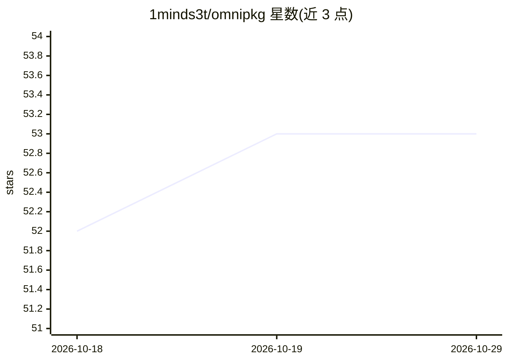

# 1minds3t/omnipkg

⭐ 53 · Python · NOASSERTION · 推送 2026-06-11 · [GitHub](https://github.com/1minds3t/omnipkg) · [官网](https://omnipkg.pages.dev/) · 个人维护 · 中文 README

**在同一环境并发运行多个 Python 包与解释器版本的管理工具**

omnipkg 是一个持久守护进程，通过隔离的 Python worker 进程（bubbles）在同一环境中同时运行冲突的包版本与不同 Python 解释器（CPython 3.7–3.15）。C dispatcher 直连 daemon socket 跳过 Python 启动，版本切换通过拦截 uv 的安装计划并以原子重命名完成。支持跨 worker 的 CUDA IPC 张量传递、ABI 感知的 numpy 后端自动注入、环境快照导出/恢复，以及 24 语言 i18n。提供 pip/uv/conda-forge/Docker 安装途径，覆盖 Linux/Windows/macOS 多平台预编译 wheel。声明双许可。

## 筛选速览

| 维度 | 判定 | 备注 |
|---|---|---|
| AI 角色 | `ai-ecosystem` | LLM/agent 周边工具 |
| 许可风险 | `none` | NOASSERTION |
| 部署形态 | `self-host` | docker 或自建部署 |
| 模型依赖 | — | README 未给出锁定关系 |
| 硬件要求 | — | 无带数字的原话,不猜 |
| 安装摩擦 | `low` | 无编译、无系统依赖或容器化 |
| 成熟度 | — | 结构信号不足 |

## 能力要点

- 同一脚本内同时运行冲突包版本与不同 Python 解释器，无需容器或独立虚拟环境
- C dispatcher 启动 237µs，版本切换通过原子 os.rename 约 0.1ms 完成
- 跨 worker 的 Universal CUDA IPC 传递 GPU 张量，数据不离开 VRAM
- ABI 感知后端注入：按知识库自动预注入匹配的 numpy 版本

## 适用场景

- 同一脚本中同时使用 torch 不同 CUDA 版本并传递 GPU 张量
- 在不建多个虚拟环境的情况下切换包版本
- 导出内容寻址 TOML 锁文件以复现完整环境
- 外部工具损坏环境后用 8pkg revert 恢复

## 场景标签

 · 领域:开发工具/Python 环境管理

## 证据(README 行号)

> L82: omnipkg is a persistent daemon that manages isolated Python worker processes ("bubbles"), each with its own package
> L84: You can run `torch==1.13.1+cu116` and `torch==2.2.0+cu121` **simultaneously in the same script**, pass GPU tensors 

## 星数曲线

2026-10-18 52 → 2026-10-29 53（+1）

---
*卡片 v1 · prompt 1.4 · 生成 2026-10-24 · 置信度 mid · 依据 README sha `c53310046b80` · [字段定义](../../DATASET.md)*
